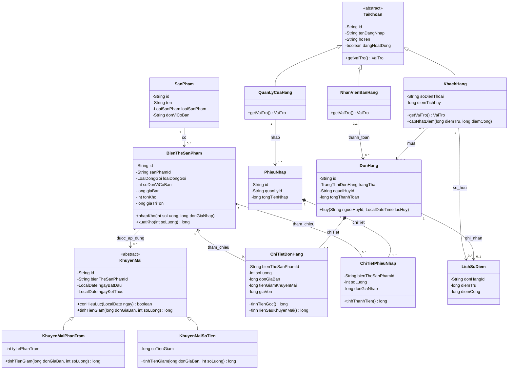

# 04. Thiết kế các lớp Java 24

## 1. Cách tổ chức

Mỗi lớp/enum dưới đây được đặt trong **một file Java riêng**, tên file trùng tên lớp/enum. Tài liệu mô tả thiết kế dự kiến, chưa tạo các file mã nguồn. Dùng lớp thông thường để dễ trình bày constructor, thuộc tính `private`, phương thức và kế thừa; không cần tính năng preview của Java 24.

```text
src/
  Main.java
  model/
    TaiKhoan.java                 (abstract)
    KhachHang.java
    NhanVienBanHang.java
    QuanLyCuaHang.java
    SanPham.java
    BienTheSanPham.java
    KhuyenMai.java                 (abstract)
    KhuyenMaiPhanTram.java
    KhuyenMaiSoTien.java
    DonHang.java
    ChiTietDonHang.java
    PhieuNhap.java
    ChiTietPhieuNhap.java
    LichSuDiem.java
    VaiTro.java                    (enum)
    LoaiSanPham.java               (enum)
    LoaiDongGoi.java               (enum)
    TrangThaiDonHang.java          (enum)
    KenhBan.java                   (enum)
  service/
    DichVuTaiKhoan.java
    DichVuSanPham.java
    DichVuKhuyenMai.java
    DichVuBanHang.java
    DichVuNhapHang.java
    DichVuBaoCao.java
  storage/
    DuLieuCuaHang.java
    LuuTruFile.java
  ui/
    GiaoDienConsole.java
  view/
    SanPhamHienThi.java
    ChiTietDonHienThi.java
    DonHangHienThi.java
  util/
    QuyTacDiemTichLuy.java
data/
  cuahang.properties              (được tạo khi triển khai)
```

Tổng dự kiến: **28 lớp**, gồm 14 lớp miền nghiệp vụ, 6 dịch vụ, 2 lớp lưu trữ, 1 giao diện console, 1 tiện ích, `Main` và 3 lớp dữ liệu hiển thị; thêm **5 enum**. Có 2 lớp trừu tượng, 3 lớp con tài khoản và 2 lớp con khuyến mãi. Không có lớp tự định nghĩa lồng trong lớp khác.

Chỉ các lớp miền có dữ liệu nghiệp vụ mới ánh xạ sang “bảng”. `Main`, giao diện, dịch vụ, tiện ích và các lớp hiển thị không tương ứng với bảng. Xem từ điển thuộc tính đầy đủ ở [tài liệu 05](05-mo-hinh-du-lieu-va-luu-tru.md).

## 2. Sơ đồ lớp chính



Đây là UML rút gọn để đọc quan hệ. ER ở tài liệu 05 bổ sung các khóa và vai trò tham chiếu. Đơn chứa các đối tượng chi tiết bằng composition; việc chứa một đối tượng **không có nghĩa** khai báo lớp chi tiết thành nested class.

## 3. Nhóm tài khoản

| File / loại lớp | Thuộc tính | Phương thức và trách nhiệm |
| --- | --- | --- |
| `TaiKhoan.java` — `abstract` | `id`, `tenDangNhap`, `hoTen`, `matKhauBam`, `muoiMatKhau`, `thuatToanBam`: `String`; `soVongLap: int`; `dangHoatDong: boolean` | Constructor kiểm tra dữ liệu chung; `abstract VaiTro getVaiTro()`; cập nhật trạng thái hoạt động và thông tin xác thực qua nghiệp vụ được phép |
| `KhachHang.java` — extends `TaiKhoan` | Thêm `soDienThoai: String`, `diemTichLuy: long` | `getVaiTro()` trả `KHACH_HANG`; `capNhatDiem(long diemTru, long diemCong)` kiểm tra đủ điểm, số không âm và chống tràn trước khi cập nhật |
| `NhanVienBanHang.java` — extends `TaiKhoan` | Chỉ dùng thuộc tính chung | `getVaiTro()` trả `NHAN_VIEN_BAN_HANG`; danh tính để truy vết người lập đơn/thu tiền |
| `QuanLyCuaHang.java` — extends `TaiKhoan` | Chỉ dùng thuộc tính chung | `getVaiTro()` trả `QUAN_LY_CUA_HANG`; danh tính để truy vết người nhập hàng và kiểm tra quyền quản lý |

Không sao chép các trường chung vào lớp con. Không thêm lương, ca làm hoặc địa chỉ giao hàng khi chưa có chức năng sử dụng. Vai trò trả về theo lớp con, không có `setVaiTro()` để đổi khách thành quản lý. Tài khoản chỉ giữ dữ liệu/hành vi của tài khoản; không nhập console, không in menu và không tự đọc file.

`DichVuTaiKhoan` xử lý đăng ký, xác thực, đổi mật khẩu, tạo nhân viên và khóa tài khoản. Dùng KDF có salt riêng, chẳng hạn `PBKDF2WithHmacSHA256` trong thư viện chuẩn; không dùng mật khẩu rõ hoặc chỉ băm nhanh một lần. Danh sách hiển thị không chứa thông tin băm/salt.

## 4. Nhóm sản phẩm

| File | Thuộc tính | Phương thức và trách nhiệm |
| --- | --- | --- |
| `SanPham.java` | `id`, `ten`, `donViCoBan`, `moTa: String`; `loaiSanPham: LoaiSanPham`; `dangKinhDoanh: boolean` | `id`, `donViCoBan` bất biến; sửa tên/mô tả/phân loại chỉ để hiệu chỉnh cùng mặt hàng vật lý; ngừng hoặc mở bán. Không chứa số tồn/giá của nhiều quy cách trong một trường |
| `BienTheSanPham.java` | `id`, `sanPhamId: String`; `loaiDongGoi: LoaiDongGoi`; `soDonViCoBan`, `tonKho: int`; `giaBan`, `giaTriTon: long`; `dangKinhDoanh: boolean` | `doiGiaBan(long giaMoi)`, `nhapKho(int soLuong, long donGiaNhap)`, `xuatKho(int soLuong): long`; phương thức xuất trả về tổng giá vốn dòng và giảm tồn cùng giá trị tồn |

`id`, `sanPhamId`, `loaiDongGoi`, `soDonViCoBan` của SKU bất biến sau tạo. Constructor khởi tạo tồn mới bằng 0; dữ liệu nạp file phải đi qua đường khôi phục có kiểm tra riêng. Không cung cấp `setTonKho()` hoặc `setGiaTriTon()` tùy ý cho UI.

Không sửa sản phẩm đang có để biến thành mặt hàng khác dung tích, khối lượng hoặc hương vị; trường hợp đó tạo `SanPham` và SKU mới, giữ nguyên định danh và đơn vị cơ bản của hàng cũ để tồn kho/lịch sử vẫn cùng ý nghĩa.

`xuatKho()` kiểm tra đủ số lượng rồi tính `floor(giaTriTon × soLuong / tonKho)` theo [tài liệu 06](06-quy-tac-nghiep-vu-va-kiem-thu.md). Chỉ gọi nhập/xuất trên bộ dữ liệu ứng viên của giao dịch, không sửa đối tượng đang dùng trước khi lưu thành công.

Không kế thừa `LocSua` từ `Sua`, cũng không kế thừa `ThungSua` từ `LocSua`: quy cách là thuộc tính của SKU. Năm nhóm hàng hiện có cùng hành vi nên `LoaiSanPham` là đủ; kế thừa được thể hiện ở những nơi có vai trò/hành vi khác nhau.

## 5. Nhóm khuyến mãi

| File / loại lớp | Thuộc tính | Phương thức và trách nhiệm |
| --- | --- | --- |
| `KhuyenMai.java` — `abstract` | `id`, `bienTheSanPhamId`, `ten: String`; `ngayBatDau`, `ngayKetThuc: LocalDate`; `dangHoatDong: boolean` | `conHieuLuc(LocalDate ngay): boolean`; `abstract long tinhTienGiam(long donGiaBan, int soLuong)`; ngừng chương trình |
| `KhuyenMaiPhanTram.java` — extends `KhuyenMai` | Thêm `tyLePhanTram: int`, từ 1 đến 100 | Override `tinhTienGiam`: với `B = donGiaBan × soLuong`, trả `floor(B × tyLePhanTram / 100)`, tính trung gian an toàn |
| `KhuyenMaiSoTien.java` — extends `KhuyenMai` | Thêm `soTienGiam: long`, mức giảm cho mỗi đơn vị SKU, dương | Override `tinhTienGiam`: `min(donGiaBan, soTienGiam) × soLuong` cho dòng SKU |

Hai lớp con dùng cùng hợp đồng: `donGiaBan > 0`, `soLuong > 0`; tính `B` bằng `Math.multiplyExact(donGiaBan, soLuong)` và từ chối nếu vượt miền `long`. Đầu ra là số VND giảm trên dòng, nằm từ 0 đến `B`. Phần trăm dùng `BigInteger` cho phép nhân/chia trung gian rồi `longValueExact()`; giảm số tiền dùng `Math.multiplyExact` sau khi chặn mức giảm mỗi đơn vị. Chương trình chỉ áp dụng cho một SKU. Lọc ngày, trạng thái và chọn chương trình tốt nhất do `DichVuKhuyenMai` thực hiện; lớp con chỉ chịu trách nhiệm công thức.

Ví dụ đa hình: với biến kiểu `KhuyenMai`, lời gọi `khuyenMai.tinhTienGiam(50_000, 2)` trả 10.000 khi đối tượng là giảm 10%, hoặc trả 30.000 khi đối tượng là giảm 15.000 đ/đơn vị SKU. `DichVuBanHang` và `DichVuKhuyenMai.chonKhuyenMaiTotNhat` đều truyền đơn giá cùng số lượng vào hợp đồng này, không tự viết nhánh tính công thức theo từng loại khuyến mãi.

Chưa cần thêm interface có cùng phương thức với `KhuyenMai`; abstract class đã cung cấp phần dữ liệu chung và hợp đồng trừu tượng. Đa hình runtime nằm ở các phương thức instance được override, không phải ở các phương thức `static`.

## 6. Nhóm giao dịch và điểm

| File | Thuộc tính chính | Phương thức và trách nhiệm |
| --- | --- | --- |
| `DonHang.java` | Các ID người tạo/khách/thu ngân; `nguoiHuyId: String?`; kênh bán, trạng thái; thời điểm tạo/trả/hủy; `List<ChiTietDonHang> chiTiet`; các tổng tiền và điểm ở tài liệu 05 | `huy(String nguoiHuyId, LocalDateTime lucHuy)` chỉ từ trạng thái chờ; `xacNhanThanhToan(...)` nhận danh sách chi tiết mới và kết quả đã tính, kiểm tra chuyển trạng thái đúng một lần; không tự đọc giá hoặc ghi file |
| `ChiTietDonHang.java` — `final` | `bienTheSanPhamId`, tên/quy cách tại lúc bán, `soLuong`, `donGiaBan`, mã/mô tả khuyến mãi, `tienGiamKhuyenMai`, `giaVon`; mọi trường `private final` | Constructor kiểm tra dữ liệu; `tinhTienGoc(): long`; `tinhTienSauKhuyenMai(): long`; bản chụp bất biến, không có setter |
| `PhieuNhap.java` | `id`, `quanLyId`, `thoiDiemNhap`, `tenNhaCungCap`, `tongTienNhap`, `List<ChiTietPhieuNhap> chiTiet` | Constructor kiểm tra danh sách không rỗng/không trùng SKU và tự tính tổng từ chi tiết; phiếu đã ghi là bất biến |
| `ChiTietPhieuNhap.java` — `final` | `bienTheSanPhamId`, tên/quy cách lúc nhập, `soLuong`, `donGiaNhap`; mọi trường `private final` | Constructor kiểm tra số lượng và đơn giá nhập dương; `tinhThanhTien(): long`; bất biến, không có setter |
| `LichSuDiem.java` | `id`, `khachHangId`, `donHangId`, `thoiDiem`, `diemTru`, `diemCong` | Bản ghi bất biến để giải thích thay đổi điểm; đúng một bản ghi cho mỗi đơn đã trả của thành viên; không lưu số dư sau từng đơn |

`ChiTietDonHang` và `ChiTietPhieuNhap` không cần ID riêng: trong một giao dịch mỗi SKU chỉ xuất hiện một lần. ID giao dịch cha được suy ra từ đối tượng chứa danh sách. Các tổng trên đơn do code tính, không nhận tổng do người dùng nhập làm kết quả tin cậy.

`DonHang` và `PhieuNhap` dùng `List.copyOf(chiTiet)` ngay trong constructor; `DonHang.xacNhanThanhToan(...)` cũng sao chép danh sách thay thế theo cách này. Getter chỉ trả danh sách bất biến đã giữ. Do từng phần tử cũng bất biến, bên giữ danh sách đầu vào hoặc phần tử cũ không thể sửa giao dịch qua tham chiếu dùng chung. Khi tính lại giá/khuyến mãi/giá vốn, service tạo các `ChiTietDonHang` mới và thay toàn bộ danh sách trên đơn thuộc bộ dữ liệu ứng viên, không sửa dòng cũ.

`diemSuDung` trong đơn chờ là đề nghị, chưa trừ số dư. `diemNhanDuoc` bằng 0 ở đơn chờ/hủy và được chốt khi thanh toán. Đơn đã trả không có setter đổi khách, dòng hàng, tiền hoặc điểm. Số dư hiện tại đọc từ `KhachHang.diemTichLuy` và đối chiếu với tổng điểm cộng/trừ của lịch sử; không thêm trường số dư sau mỗi đơn khi chưa có thứ tự giao dịch riêng.

`nguoiHuyId` và `thoiDiemHuy` bắt buộc có khi đơn đã hủy và phải vắng mặt ở trạng thái khác. `DichVuBanHang.huyDon` lấy người hủy từ phiên đang đăng nhập, kiểm tra tài khoản còn hoạt động và là khách sở hữu đơn hoặc nhân viên bán hàng rồi mới gọi `huy(...)`; không nhận danh tính người hủy do người mua tự gõ. Các tham chiếu này được giữ khi tài khoản bị khóa để truy vết việc hủy.

Không tạo lớp miền `HoaDon` riêng vì đơn đã thanh toán đã chứa dữ liệu hóa đơn; UI in từ `DonHangHienThi` đã được lọc quyền. Không tạo lớp `ThanhToan` riêng khi chỉ có một lần xác nhận nhận tiền tại cửa hàng, chưa có thanh toán nhiều đợt/phương thức.

## 7. Các enum

| File | Các giá trị |
| --- | --- |
| `VaiTro.java` | `KHACH_HANG`, `NHAN_VIEN_BAN_HANG`, `QUAN_LY_CUA_HANG` |
| `LoaiSanPham.java` | `KEM`, `SUA`, `SUA_CHUA`, `NUOC_GIAI_KHAT`, `PHO_MAI` |
| `LoaiDongGoi.java` | `LE`, `LOC`, `THUNG` |
| `TrangThaiDonHang.java` | `CHO_THANH_TOAN`, `DA_THANH_TOAN`, `DA_HUY` |
| `KenhBan.java` | `DAT_TRUOC`, `TAI_QUAY` |

Enum tránh dùng chuỗi tùy ý hoặc số khó hiểu để biểu diễn vai trò/trạng thái. Mỗi enum là khai báo ở cấp cao nhất trong file riêng, không đặt trong một lớp khác.

## 8. Dịch vụ nghiệp vụ

Các tên phương thức dưới đây thể hiện các thao tác cần có; các tham số nhập liệu còn lại được chốt khi lập trình theo từ điển dữ liệu. Hợp đồng dữ liệu hiển thị và xác nhận báo giá dưới đây là bắt buộc. Tất cả dịch vụ dùng phương thức instance, nhận phần lưu trữ và dịch vụ liên quan qua constructor.

| File | Phương thức chính | Lớp/dữ liệu phối hợp |
| --- | --- | --- |
| `DichVuTaiKhoan.java` | `khoiTaoQuanLy`, `dangKyKhachHang`, `dangNhap`, `doiMatKhau`, `taoNhanVien`, `khoaTaiKhoan`, `moKhoaTaiKhoan`, `timKhachHang` | `TaiKhoan` và ba lớp con; chuẩn hóa tên/số điện thoại, băm và kiểm tra mật khẩu; `dangNhap` trả ID tài khoản cho phiên, không trả entity xác thực |
| `DichVuSanPham.java` | `timSanPham(...): List<SanPhamHienThi>`, `xemDanhSachDangBan(...): List<SanPhamHienThi>`; `themSanPham`, `capNhatSanPham`, `themBienThe`, `doiGiaBan`, `ngungBan`, `moBan`; `xemTonKho(...): Map<String, Integer>` | `SanPham`, `BienTheSanPham`; kết quả tìm/xem chỉ chứa dữ liệu bán công khai; map SKU → số tồn chỉ đọc dành cho nhân viên/quản lý |
| `DichVuKhuyenMai.java` | `taoKhuyenMai`, `ngungKhuyenMai`, `chonKhuyenMaiTotNhat(..., long donGiaBan, int soLuong)` | `KhuyenMai` và hai lớp con; phương thức chọn nội bộ trả `Optional<KhuyenMai>`, rỗng nếu không có giảm giá dương; không trả entity có thể sửa ra UI |
| `DichVuBanHang.java` | `tinhTamDon(...): DonHangHienThi`; `datHang`, `lapDonTaiQuay`, `xemDon`, `huyDon` trả `DonHangHienThi`; `thanhToan(actor, donId, diem, quoteDaXacNhan): DonHangHienThi` | Danh mục, khuyến mãi, đơn, điểm; đây là nơi chung cho cả hai luồng bán, kiểm tra quyền sở hữu đơn và ràng buộc báo giá khách đã xác nhận |
| `DichVuNhapHang.java` | `lapPhieuNhap`, `xemPhieuNhap` | Phiếu/chi tiết nhập, SKU, người quản lý; cộng hàng và giá trị tồn cùng lần lưu |
| `DichVuBaoCao.java` | `tongHopTaiChinh`, `traCuuGiaoDich` | Đơn đã thanh toán, giá vốn dòng, phiếu nhập; chỉ đọc, kiểm tra quyền quản lý |

Đầu vào hành động nhạy cảm phải kèm ngữ cảnh tài khoản đang đăng nhập, không dùng ID người thực hiện do người mua tự gõ. Một phương thức kiểm tra quyền chung trong `DichVuTaiKhoan` có thể dùng lại; chưa cần lớp quản lý quyền riêng. Quyền đọc cũng được kiểm tra tại dịch vụ, không chỉ quyền ghi.

`timKhachHang` chỉ trả kết quả chỉ đọc gồm ID, họ tên, số điện thoại và số điểm hiện có theo quyền tra cứu; không trả `TaiKhoan`, hash, salt hoặc tham số KDF. Danh sách tài khoản cho quản lý cũng chỉ chứa các trường hồ sơ và trạng thái cần dùng. Các kết quả công khai không giữ tham chiếu đến entity có thể sửa trong bộ dữ liệu.

Kết quả tổng hợp tài chính có một tập chỉ tiêu cố định; giai đoạn đầu có thể trả một `Map<String, Long>` chỉ đọc với các khóa đã thống nhất theo tài liệu 06. Chưa cần thêm lớp báo cáo hoặc lớp biểu đồ. Dịch vụ không in console; UI nhận kết quả và định dạng.

### 8.1. Ba lớp dữ liệu hiển thị

Đặt đúng ba lớp sau trong package `view`, mỗi lớp là `public final` ở file riêng. Mọi thuộc tính là `private final`, được kiểm tra trong constructor, chỉ có getter và không có setter. Chúng là bản sao dữ liệu được cho phép hiển thị, không chứa `TaiKhoan`, `BienTheSanPham`, `DonHang` hoặc entity có thể sửa khác.

| Lớp | Nội dung được trả về |
| --- | --- |
| `SanPhamHienThi` | Mỗi bản ghi ứng với một SKU: mã sản phẩm/SKU, tên, loại, mô tả sản phẩm, mô tả đóng gói, giá bán, nội dung khuyến mãi công khai và `conHang: boolean`; không có số tồn chính xác hoặc giá vốn |
| `ChiTietDonHienThi` | Mã SKU, tên/quy cách bản chụp, số lượng, đơn giá bán, mã/mô tả khuyến mãi, tiền giảm và các thành tiền dòng; không có `giaVon` |
| `DonHangHienThi` | Mã đơn nếu đã lưu, các ID người tạo/khách/thu ngân/người hủy, kênh bán, trạng thái và thời điểm giao dịch nếu đã có; `List<ChiTietDonHienThi> chiTiet`; toàn bộ tổng tiền, điểm đề nghị/đã dùng/được nhận, giới hạn điểm hiện tại khi tính giá; `thoiDiemTinhGia: LocalDateTime?` |

`DonHangHienThi` dùng `List.copyOf(chiTiet)` ngay trong constructor; các danh sách kết quả của service cũng là bản sao chỉ đọc. Không lớp nào trong ba lớp chứa thông tin xác thực, giá nhập, giá vốn, giá trị tồn hoặc số tồn chính xác. Quyền xem đơn được kiểm tra trước khi tạo bản hiển thị; view không thay thế kiểm tra quyền sở hữu.

Khi đọc đơn đã lưu bằng `xemDon`, `thoiDiemTinhGia` để trống và giữ đúng snapshot của đơn. Khi dùng làm báo giá tạm từ `tinhTamDon`, trường này bắt buộc có giá trị theo giờ cửa hàng; mã đơn/trạng thái để trống nếu giỏ chưa tạo thành đơn. Báo giá của đơn chờ có mã đơn và trạng thái `CHO_THANH_TOAN`. `thoiDiemTinhGia` chỉ nằm trong kết quả tạm, không lưu vào mô hình giao dịch.

Điểm nhận trong báo giá là dự kiến nếu thanh toán thành công, không cập nhật `DonHang.diemNhanDuoc` của đơn chờ đang lưu. Giới hạn điểm hiện tại chỉ xuất hiện khi tính báo giá; đọc lại chứng từ cũ không tính giới hạn này từ số dư mới.

Nhân viên/quản lý xem tồn chính xác qua `xemTonKho` trả map chỉ đọc, không mở thêm getter dữ liệu nhạy cảm trên `SanPhamHienThi`. Quản lý xem chi phí qua `tongHopTaiChinh`, phiếu nhập bất biến từ `xemPhieuNhap` hoặc map giá vốn theo giao dịch/SKU chỉ đọc từ `traCuuGiaoDich`. Không trả đơn miền có thể sửa ra UI và không thêm hệ phân cấp view cho từng vai trò.

### 8.2. Báo giá và xác nhận thanh toán

UI lấy `DonHangHienThi` tạm từ `tinhTamDon`, hiển thị các dòng, từng khoản giảm, số điểm và tổng tiền để khách xác nhận. Sau đó gọi `thanhToan(actor, donId, diem, quoteDaXacNhan)` với chính báo giá bất biến đã hiển thị; `actor` lấy từ phiên. Service vẫn tự kiểm tra quyền, đơn chờ, khách, tồn và điểm, không coi tiền trong quote là kết quả tính tin cậy.

Mỗi lần gọi `thanhToan` lấy đúng một thời điểm `now` theo giờ cửa hàng, dùng ngày của nó cho tất cả chương trình và dùng chính `now` làm thời điểm thanh toán nếu lưu thành công. Tính lại báo giá từ dữ liệu hiện hành rồi so toàn bộ nội dung nghiệp vụ với quote đã xác nhận: mã đơn/khách/kênh, từng SKU và số lượng, tên/quy cách, đơn giá, mã/mô tả/tiền giảm khuyến mãi, các tổng tiền, điểm dùng/nhận và giới hạn điểm, cùng ngày cửa hàng của `thoiDiemTinhGia`. So ngày tính giá, không so chính xác giờ/phút/giây, để một báo giá không tự hết hiệu lực chỉ vì thời gian chạy qua vài giây.

Nếu khác bất kỳ nội dung nào hoặc quote không phải báo giá của đúng đơn, không ghi dữ liệu; trả báo giá mới có `thoiDiemTinhGia = now`, trạng thái `CHO_THANH_TOAN` để UI yêu cầu khách xác nhận lại. Nếu hợp lệ và khớp, tạo bộ ứng viên, chốt các dòng mới, xuất kho/cập nhật điểm, lưu rồi trả bản hiển thị `DA_THANH_TOAN`. Nhờ vậy, khuyến mãi hết hạn qua nửa đêm hoặc báo giá cũ sau khi dữ liệu đổi không làm thu tiền khác nội dung khách vừa đồng ý.

## 9. Lưu trữ, giao diện và điểm vào

| File | Trách nhiệm | Phương thức chính |
| --- | --- | --- |
| `DuLieuCuaHang.java` | Chứa 7 map: tài khoản, sản phẩm, SKU, đơn hàng, phiếu nhập, khuyến mãi, lịch sử điểm. Danh sách chi tiết nằm trong giao dịch cha | Tra cứu theo ID, tạo bản sao phục vụ ghi giao dịch, kiểm tra ràng buộc giữa các tập dữ liệu |
| `LuuTruFile.java` | Giữ đường dẫn file và tham chiếu bộ dữ liệu hiện hành; chuyển giữa đối tượng và Properties; công bố trạng thái mới sau lưu thành công | `nap(): DuLieuCuaHang`; `getDuLieu(): DuLieuCuaHang`; `luu(DuLieuCuaHang ungVien): void` |
| `GiaoDienConsole.java` | Menu ba vai trò, nhận dữ liệu, kiểm tra định dạng đầu vào, giữ phiên và giỏ tạm, gọi service, in kết quả/lỗi dễ hiểu | `chay()`, `hienThiMenuKhachHang()`, `hienThiMenuNhanVien()`, `hienThiMenuQuanLy()`, `inHoaDon(...)` |
| `Main.java` | Khởi tạo lưu trữ, các dịch vụ và UI, bắt đầu vòng lặp | `public static void main(String[] args)` |

Mỗi service dùng **cùng một instance `LuuTruFile`** và lấy bộ dữ liệu hiện hành lúc bắt đầu thao tác. Không giữ riêng tham chiếu cũ đến `DuLieuCuaHang` sau khi một service đã lưu bản mới. UI giữ ID tài khoản đăng nhập để tra lại từ bộ dữ liệu hiện hành; không giữ đối tượng tài khoản cũ chứa số dư điểm đã lỗi thời.

Khi ghi, service tạo bộ dữ liệu ứng viên độc lập, thực hiện nghiệp vụ trên đó và gọi `LuuTruFile.luu`. Nếu đọc/ghi thất bại, ném lỗi phù hợp để UI báo, không nuốt lỗi rồi thông báo thành công. Thuật toán lưu nguyên tử và quy tắc khôi phục nằm ở tài liệu 05.

Các entity không công khai collection đang sửa được. Map của bộ dữ liệu chỉ được dịch vụ/lưu trữ sử dụng qua cách truy cập kiểm soát; UI nhận view hoặc kết quả bất biến đã lọc quyền, không nhận entity có thể sửa. Không thêm repository/DAO/ORM vì chưa có nhu cầu ngoài một file và collection.

## 10. Yêu cầu “class static” không dùng nested class

**Không thể đồng thời có một lớp Java độc lập khai báo bằng modifier `static` và không dùng lớp lồng nhau.** Java 24 cấm `static` trên lớp ở cấp cao nhất. [JLS 24, mục 7.6](https://docs.oracle.com/javase/specs/jls/se24/html/jls-7.html#jls-7.6) và [mục 8.1.1.4](https://docs.oracle.com/javase/specs/jls/se24/html/jls-8.html#jls-8.1.1.4) quy định giới hạn này.

Phương án đề xuất cho đồ án là **lớp tiện ích có thành viên tĩnh** `QuyTacDiemTichLuy`, đặt ở file riêng. Lớp có constructor `private` để không tạo đối tượng, `final` để không kế thừa, hằng số và phương thức `static` để gọi trực tiếp bằng tên lớp. Cách ngăn khởi tạo được mô tả tại [JLS 24, mục 8.8.10](https://docs.oracle.com/javase/specs/jls/se24/html/jls-8.html#jls-8.8.10).

Ví dụ mã dự kiến cho `util/QuyTacDiemTichLuy.java`:

```java
package util;

public final class QuyTacDiemTichLuy {
    public static final long TIEN_DE_NHAN_MOT_DIEM = 10_000;
    public static final long GIA_TRI_MOT_DIEM = 1_000;

    private QuyTacDiemTichLuy() {}

    public static long tinhDiemNhan(long tienThucTra) {
        if (tienThucTra < 0) {
            throw new IllegalArgumentException("Tiền thực trả không được âm");
        }
        return tienThucTra / TIEN_DE_NHAN_MOT_DIEM;
    }

    public static long tinhDiemToiDa(long diemHienCo, long tienSauKhuyenMai) {
        if (diemHienCo < 0 || tienSauKhuyenMai < 0) {
            throw new IllegalArgumentException("Điểm và tiền không được âm");
        }
        return Math.min(diemHienCo, tienSauKhuyenMai / 2 / GIA_TRI_MOT_DIEM);
    }

    public static long tinhTienGiam(long diemSuDung) {
        if (diemSuDung < 0) {
            throw new IllegalArgumentException("Điểm sử dụng không được âm");
        }
        return Math.multiplyExact(diemSuDung, GIA_TRI_MOT_DIEM);
    }
}
```

Không có biến trạng thái khách hàng/tồn kho `static`. `DichVuBanHang` gọi các hàm tính trên và chịu trách nhiệm kiểm tra điểm yêu cầu không vượt mức tối đa. `tinhTienGiam()` chỉ chuyển điểm thành tiền, không tự quyết định khách có đủ điểm.

Các kiểm tra nhỏ cho đoạn minh họa, đặt trong phương thức kiểm tra khi triển khai và chạy với `-ea`:

```java
assert QuyTacDiemTichLuy.tinhDiemNhan(141_000) == 14;
assert QuyTacDiemTichLuy.tinhDiemToiDa(50, 161_000) == 50;
assert QuyTacDiemTichLuy.tinhDiemToiDa(100, 19_999) == 9;
assert QuyTacDiemTichLuy.tinhTienGiam(20) == 20_000;
assert QuyTacDiemTichLuy.tinhDiemNhan(0) == 0;
```

Không gọi lớp này là lớp có modifier `static`: `final` cũng không có nghĩa là `static`. Phương án đáp ứng việc sử dụng thành viên tĩnh trong một lớp độc lập. Nếu giảng viên yêu cầu đúng cú pháp `static class`, cần điều chỉnh tiêu chí đó hoặc cho phép lớp lồng nhau; không có mã top-level hợp lệ đáp ứng nguyên văn cả hai điều kiện. Tài liệu hiện giữ yêu cầu **không dùng nested class** và công khai điểm không thể đáp ứng theo nghĩa đen.

### 10.1. Kiểm kê thành viên `static`

Phân biệt khai báo thuộc project với lời gọi thư viện; bảng này kiểm kê thiết kế dự kiến, không khẳng định các lớp đã có mã nguồn.

| Nơi khai báo | Thành viên `static` tường minh dự kiến |
| --- | --- |
| `Main` | Một phương thức `public static void main(String[] args)` làm điểm vào |
| `QuyTacDiemTichLuy` | Hai hằng `public static final long TIEN_DE_NHAN_MOT_DIEM`, `GIA_TRI_MOT_DIEM`; ba phương thức `public static long tinhDiemNhan(...)`, `tinhDiemToiDa(...)`, `tinhTienGiam(...)` |
| Các lớp model, service, storage, UI và view còn lại | Không có thành viên `static` tường minh; phương thức nghiệp vụ, getter và dữ liệu thuộc từng instance |

Tổng tường minh dự kiến: **4 phương thức `static` và 2 hằng `static final`**, không có biến trạng thái sửa được dùng chung. Có **0 khai báo `static class`** vì mọi lớp nằm ở cấp cao nhất và không dùng nested class.

Năm enum có tổng **16 hằng enum** mang tính `public static final` và **10 phương thức `static` được Java sinh ngầm**: mỗi enum có `values()` và `valueOf(String)`. Đây là thành viên ngầm của enum, được tính riêng; không phải phương thức nghiệp vụ `static` do project tự khai báo.

Ở mã hiện tại, `src/Main.java` vẫn dùng `void main()` dạng instance: có **0 khai báo `static` tường minh**. `String.format(...)` và `IO.println(...)` trong mẫu chỉ là lời gọi phương thức `static` của thư viện. Tương tự, `Math.min`, `Math.multiplyExact`, `List.copyOf`, `UUID.randomUUID` hoặc `ZoneId.of` khi triển khai không làm tăng số thành viên `static` project tự định nghĩa.

## 11. Chứng minh bốn tính chất hướng đối tượng

| Tính chất | Cách thể hiện | Ví dụ khi trình bày |
| --- | --- | --- |
| Đóng gói | Thuộc tính `private`; constructor và phương thức nghiệp vụ kiểm tra bất biến; không lộ danh sách sửa được | `xuatKho(5)` kiểm tra đủ hàng; không cho UI gán tồn âm; thay đổi điểm thông qua nghiệp vụ thanh toán |
| Kế thừa | Ba tài khoản kế thừa `TaiKhoan`; hai công thức kế thừa `KhuyenMai` | Tài khoản dùng chung thông tin xác thực/tên và phân loại vai trò; khuyến mãi dùng chung ngày hiệu lực |
| Đa hình | Dùng biến/collection kiểu cha, gọi phương thức instance được override | `List<KhuyenMai>` có nhiều loại nhưng đều gọi `tinhTienGiam(donGiaBan, soLuong)` và thực thi công thức khác nhau |
| Trừu tượng | Lớp abstract mô tả hợp đồng, che công thức chi tiết sau phương thức | Service biết “tính tiền giảm” mà không cần biết cách tính phần trăm hay số tiền |

Kế thừa tài khoản chủ yếu phục vụ phân loại vai trò và chia sẻ dữ liệu trong đồ án; `getVaiTro()` chỉ trả các giá trị khác nhau, không phải ví dụ mạnh về đa hình hành vi. Đa hình hành vi thực sự được minh họa bằng hai công thức khuyến mãi dùng cùng hợp đồng. Composition được thể hiện qua đơn/phiếu nhập chứa nhiều chi tiết. Tách UI, service, model và storage giúp thay cách nhập/xuất mà không viết lại công thức nghiệp vụ. Không biến toàn bộ chương trình thành các hàm `static`, vì như vậy làm yếu phần mô hình đối tượng cần trình bày.

## 12. Thứ tự triển khai đề xuất

1. Enum, sản phẩm/SKU, tài khoản và kiểm tra constructor.
2. Khuyến mãi, lớp tiện ích điểm và các ca tính tiền đơn giản.
3. Đơn hàng, phiếu nhập, lịch sử điểm và các quy tắc ở tài liệu 06.
4. Collection, đọc/ghi file và kiểm tra lỗi lưu trước khi hoàn thiện thanh toán.
5. Dịch vụ dùng chung, phân quyền, menu ba vai trò và báo cáo.
6. Chạy kịch bản nghiệm thu, đặc biệt giá/điểm thay đổi sau đặt, thanh toán lặp và lỗi ghi file.

Khi bắt đầu mã nguồn Java 24, đổi `Main` mẫu hiện có sang điểm vào cổ điển nêu trên và dùng `System.out`/`Scanner` cho console. Bộ tài liệu không cài JDK hoặc thay đổi cấu hình IDE.
