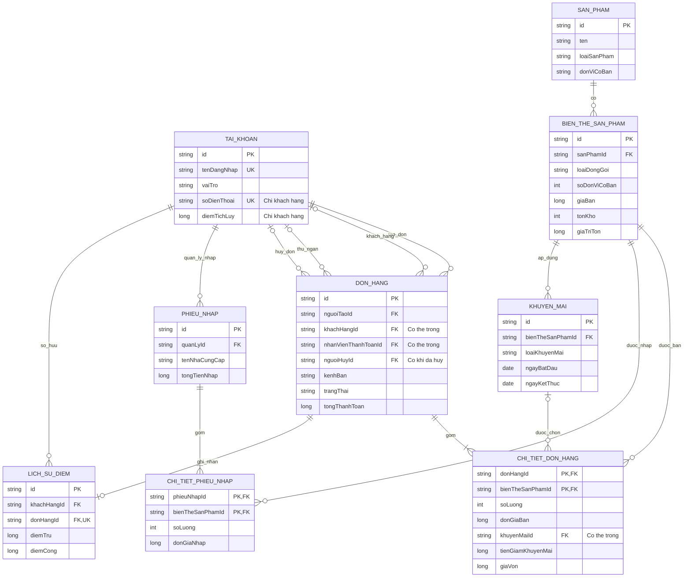

# Mô hình dữ liệu và lưu trữ bằng file

## 1. Mục đích và quy ước

Tài liệu này mô tả dữ liệu của ứng dụng Java 24 theo cách thường dùng khi thiết kế cơ sở dữ liệu: thực thể, khóa chính, khóa ngoại, quan hệ và ràng buộc. **Ứng dụng không tạo database, không chạy SQL và không cần JDBC.** Các “bảng” dưới đây là bảng logic để thiết kế lớp; chương trình làm việc với đối tượng Java và lưu chúng vào một file.

- Mỗi khóa chính độc lập có kiểu `String`, sinh bằng `UUID.randomUUID().toString()`. Các mã như `SP001` hoặc `SKU001` nếu xuất hiện trong ví dụ nghiệp vụ chỉ là ký hiệu minh họa.
- `PK`: khóa chính; `FK`: mã tham chiếu đến đối tượng khác; `UQ`: giá trị hoặc tổ hợp giá trị phải duy nhất. Java phải tự kiểm tra các ràng buộc này.
- Dấu `?` sau kiểu dữ liệu nghĩa là được phép không có giá trị. Các trường còn lại là bắt buộc, trừ khi ghi rõ điều kiện theo loại đối tượng.
- Tiền dùng `long`, đơn vị đồng Việt Nam, không dùng `double`. Số tiền, số điểm và số lượng tồn kho không âm. Số lượng trên một dòng mua hoặc nhập phải lớn hơn `0`.
- Ngày khuyến mãi dùng `LocalDate`; thời điểm giao dịch dùng `LocalDateTime`, lấy theo `ZoneId.of("Asia/Ho_Chi_Minh")`. Khi lưu file, dùng định dạng ISO, ví dụ `2026-10-19` và `2026-10-19T14:30:00`.
- Tất cả `LocalDateTime` trong dữ liệu có cùng múi giờ cửa hàng nêu trên. Với báo cáo từ ngày A đến hết ngày B, lọc từ `A.atStartOfDay()` đến trước `B.plusDays(1).atStartOfDay()`.
- Không dùng xóa cứng đối tượng đã được tham chiếu trong giao dịch. Ngừng kinh doanh sản phẩm hoặc biến thể, khóa tài khoản, tắt khuyến mãi bằng cờ trạng thái tương ứng.
- Mỗi lớp được khai báo trong file `.java` riêng. `List<ChiTietDonHang>` là quan hệ chứa danh sách đối tượng, không phải lớp lồng nhau.

## 2. Quan hệ giữa các thực thể



Sơ đồ thể hiện dữ liệu rút gọn; từ điển bên dưới là hợp đồng đầy đủ. Bốn đường nối tài khoản với đơn hàng biểu diễn bốn vai trò tham chiếu khác nhau, không phải bốn bảng tài khoản.

| Quan hệ | Ràng buộc cần kiểm tra trong Java |
|---|---|
| Sản phẩm → biến thể | Một sản phẩm có thể có nhiều SKU; mỗi SKU thuộc đúng một sản phẩm. Có thể tạo sản phẩm trước rồi bổ sung SKU. |
| Đơn hàng → chi tiết | Đơn hàng được lưu phải có ít nhất một dòng; mỗi dòng thuộc đúng một đơn hàng. |
| Phiếu nhập → chi tiết | Phiếu nhập được xác nhận phải có ít nhất một dòng; mỗi dòng thuộc đúng một phiếu. |
| SKU → khuyến mãi | Một SKU có nhiều chương trình theo thời gian; mỗi chương trình chỉ áp dụng cho một SKU. |
| Khách hàng → đơn hàng | Một khách hàng có nhiều đơn. Đơn `DAT_TRUOC` bắt buộc có khách hàng và `nguoiTaoId = khachHangId`; đơn `TAI_QUAY` có người tạo là nhân viên bán hàng và có thể là khách vãng lai. |
| Nhân viên → đơn hàng | Đơn đã thanh toán phải tham chiếu nhân viên bán hàng thực hiện thanh toán. Đơn chờ hoặc đã hủy chưa có người thanh toán. |
| Người hủy → đơn hàng | Chỉ đơn `DA_HUY` có người hủy: khách sở hữu đơn hoặc nhân viên bán hàng xử lý yêu cầu của khách. |
| Quản lý → phiếu nhập | Người lập phiếu phải là `QuanLyCuaHang`. |
| Đơn hàng → lịch sử điểm | Đơn đã thanh toán có khách hàng có đúng một bản ghi điểm; đơn khách vãng lai, đơn chờ và đơn hủy không có bản ghi. |

## 3. Từ điển dữ liệu

### 3.1. TAI_KHOAN — ánh xạ hệ kế thừa tài khoản

Một bảng logic chứa dữ liệu chung và trường phân biệt `vaiTro`. Khi đọc file, tạo đúng lớp con của `TaiKhoan`, không tạo trực tiếp lớp trừu tượng.

| Trường | Kiểu Java | Khóa / ý nghĩa |
|---|---|---|
| `id` | `String` | PK. |
| `tenDangNhap` | `String` | UQ, lưu sau `trim()` và `toLowerCase(Locale.ROOT)`; không rỗng. |
| `hoTen` | `String` | Họ tên hiển thị, không rỗng. |
| `matKhauBam` | `String` | Kết quả KDF mã hóa Base64; không lưu mật khẩu gốc. |
| `muoiMatKhau` | `String` | Salt ngẫu nhiên riêng từng tài khoản, mã hóa Base64. |
| `thuatToanBam` | `String` | Tên thuật toán KDF mà ứng dụng hỗ trợ, ví dụ `PBKDF2WithHmacSHA256`. |
| `soVongLap` | `int` | Tham số số vòng lặp của KDF; kiểm tra theo chính sách của ứng dụng khi tạo và đọc tài khoản. |
| `dangHoatDong` | `boolean` | Tài khoản bị khóa không được đăng nhập. |
| `vaiTro` | `VaiTro` | `KHACH_HANG`, `NHAN_VIEN_BAN_HANG`, `QUAN_LY_CUA_HANG`; phải khớp lớp con. |
| `soDienThoai` | `String?` | Bắt buộc và UQ giữa các khách hàng; không dùng làm số học. Không có với hai vai trò còn lại trong phạm vi đồ án. |
| `diemTichLuy` | `Long?` trong bảng logic | Chỉ có với khách hàng. Trong lớp `KhachHang` là `long`, ban đầu `0`; các lớp con khác không khai báo trường này. |

Số điện thoại được chuẩn hóa bằng cách `trim()`, bỏ dấu cách và dấu `-`, đổi tiền tố `+84` thành `0`, rồi yêu cầu đúng 10 chữ số và bắt đầu bằng `0`. Kiểm tra duy nhất sau chuẩn hóa; đây là giới hạn số điện thoại Việt Nam trong đồ án. Nhân viên tìm khách thành viên bằng số đã chuẩn hóa. Khách không có tài khoản vẫn mua tại quầy nhưng không tích hoặc dùng điểm.

`vaiTro` là discriminator khi lưu trữ. Mỗi lớp con Java trả về vai trò cố định qua `getVaiTro()`; không thêm một field vai trò có thể sửa độc lập với lớp con. Khi khởi tạo bộ dữ liệu mới, màn hình console yêu cầu tạo tài khoản quản lý đầu tiên và băm mật khẩu trước khi lưu; không dùng mật khẩu mặc định viết sẵn trong mã.

### 3.2. SAN_PHAM — mặt hàng cơ sở

| Trường | Kiểu Java | Khóa / ý nghĩa |
|---|---|---|
| `id` | `String` | PK. |
| `ten` | `String` | Tên đầy đủ, ví dụ “Sữa tươi ít đường 180 ml”. |
| `loaiSanPham` | `LoaiSanPham` | `KEM`, `SUA`, `SUA_CHUA`, `NUOC_GIAI_KHAT`, `PHO_MAI`. |
| `donViCoBan` | `String` | Đơn vị nhỏ nhất của mặt hàng: hộp, chai, hũ, que, gói… |
| `moTa` | `String` | Mô tả tự do, có thể là chuỗi rỗng. |
| `dangKinhDoanh` | `boolean` | Cho phép xuất hiện trong danh sách đang bán. |

Khác dung tích, khối lượng hoặc hương vị thì tạo một `SanPham` khác. Sửa tên/mô tả chỉ hiệu chỉnh cách trình bày của cùng mặt hàng; `donViCoBan` bất biến sau tạo, không đổi nghĩa hàng hóa hoặc lượng tồn bằng cách đổi tên sản phẩm cha. Phân loại kem, sữa… là giá trị enum; không cần thêm năm lớp con chỉ để khác tên loại.

### 3.3. BIEN_THE_SAN_PHAM — SKU theo hình thức đóng gói

| Trường | Kiểu Java | Khóa / ý nghĩa |
|---|---|---|
| `id` | `String` | PK; đây là mã SKU dùng khi chọn mua hoặc nhập hàng. |
| `sanPhamId` | `String` | FK → `SanPham.id`. |
| `loaiDongGoi` | `LoaiDongGoi` | `LE`, `LOC`, `THUNG`. |
| `soDonViCoBan` | `int` | Số hộp/chai/hũ… trong một đơn vị bán của SKU. |
| `giaBan` | `long` | Giá hiện tại của **một đơn vị SKU**, lớn hơn `0`. |
| `tonKho` | `int` | Số đơn vị SKU còn lại, ban đầu `0`. |
| `giaTriTon` | `long` | Tổng giá vốn của lượng SKU đang tồn, ban đầu `0`. |
| `dangKinhDoanh` | `boolean` | Chỉ bán khi cả SKU và sản phẩm gốc đều đang kinh doanh. |

UQ: `(sanPhamId, loaiDongGoi, soDonViCoBan)`. Ba trường này bất biến ngay khi tạo SKU; muốn đổi sản phẩm hoặc quy cách thì tạo SKU mới. `LE` yêu cầu `soDonViCoBan = 1`; `LOC` và `THUNG` yêu cầu `soDonViCoBan > 1`. Không bắt buộc mọi mặt hàng đều có đủ ba kiểu đóng gói.

Ví dụ cùng một sản phẩm có ba SKU: lẻ 1 hộp giá 8.000 đồng, lốc 4 hộp giá 30.000 đồng, thùng 48 hộp giá 340.000 đồng. `tonKho = 5` của SKU thùng nghĩa là còn **5 thùng**. Giá lốc và thùng được nhập riêng, không buộc bằng giá lẻ nhân số hộp.

Tồn kho ba SKU độc lập. Bán một lốc không trừ bốn hộp ở SKU bán lẻ. Mọi SKU mới có `tonKho = 0` và `giaTriTon = 0`; tồn đầu cũng được ghi qua phiếu nhập để có chứng từ và giá vốn. Phiên bản này không tự mở thùng hoặc tách lốc; tính năng quy đổi kho nếu cần sẽ là một nghiệp vụ riêng.

### 3.4. DON_HANG

| Trường | Kiểu Java | Khóa / ý nghĩa |
|---|---|---|
| `id` | `String` | PK. |
| `nguoiTaoId` | `String` | FK → `TaiKhoan.id`; người tạo đơn. |
| `khachHangId` | `String?` | FK → tài khoản `KhachHang`; bắt buộc với `DAT_TRUOC`. |
| `nhanVienThanhToanId` | `String?` | FK → `NhanVienBanHang`; chỉ có khi đã thanh toán. |
| `nguoiHuyId` | `String?` | FK → `TaiKhoan`; có khi và chỉ khi `DA_HUY`; là khách sở hữu đơn hoặc nhân viên bán hàng. |
| `kenhBan` | `KenhBan` | `DAT_TRUOC` hoặc `TAI_QUAY`. |
| `trangThai` | `TrangThaiDonHang` | `CHO_THANH_TOAN`, `DA_THANH_TOAN`, `DA_HUY`. |
| `thoiDiemTao` | `LocalDateTime` | Thời điểm ghi nhận đơn. |
| `thoiDiemThanhToan` | `LocalDateTime?` | Có khi và chỉ khi đơn đã thanh toán. |
| `thoiDiemHuy` | `LocalDateTime?` | Có khi và chỉ khi đơn đã hủy. |
| `tongTienHang` | `long` | Tổng `soLuong × donGiaBan` của các dòng. |
| `tongGiamKhuyenMai` | `long` | Tổng giảm từ chương trình khuyến mãi sản phẩm. |
| `tienSauKhuyenMai` | `long` | `tongTienHang - tongGiamKhuyenMai`. |
| `diemSuDung` | `long` | Số điểm đề nghị ở đơn chờ hoặc số điểm đã sử dụng ở đơn đã thanh toán. |
| `tienGiamTuDiem` | `long` | `diemSuDung × 1.000`. |
| `diemNhanDuoc` | `long` | Chỉ bằng `floor(tongThanhToan / 10.000)` khi đơn `DA_THANH_TOAN` có khách thành viên; mọi trường hợp khác là `0`. |
| `tongThanhToan` | `long` | `tienSauKhuyenMai - tienGiamTuDiem`. |
| `chiTiet` | `List<ChiTietDonHang>` | Tối thiểu một dòng; không trùng SKU trong cùng đơn; sao chép thành danh sách bất biến chứa các giá trị chi tiết bất biến. |

Giỏ lựa chọn đang nhập ở console là dữ liệu tạm trong RAM, chưa phải `DonHang` lưu trữ. Sau khi xác nhận đặt hàng, mới tạo đơn `CHO_THANH_TOAN`.

Đơn chờ chỉ lưu giá, khuyến mãi, số điểm đề nghị và tiền giảm **dự kiến** để hiển thị; không giữ hàng, không trừ điểm và không ghi doanh thu. `diemNhanDuoc` vẫn bằng `0` ở đơn chờ hoặc hủy. Khi thanh toán, kiểm tra lại toàn bộ tồn kho, trạng thái sản phẩm, giá hiện tại, khuyến mãi còn hiệu lực và số dư điểm; hiển thị kết quả cuối để xác nhận trước khi ghi nhận. Mô tả và giá trên các dòng được cập nhật ở bước này. Khi nạp đơn chờ/hủy, không so số điểm đề nghị với số dư hiện tại vì khách có thể đã chi điểm ở đơn khác; kiểm tra đủ điểm tại lần thanh toán thực tế.

Kết quả xem trước thanh toán là một `DonHangHienThi` bất biến do service tạo, có `thoiDiemTinhGia`; chỉ tồn tại trong RAM, không lưu vào đơn hoặc file. Khi nhận xác nhận, `thanhToan` lấy một thời điểm hiện tại duy nhất để tính lại và làm `thoiDiemThanhToan` cuối cùng. Nếu ngày cửa hàng đã khác ngày của bản xem trước, hoặc đơn/khách hàng/kênh bán, SKU, số lượng, tên/quy cách, đơn giá, mã/mô tả khuyến mãi, tiền giảm, điểm/giới hạn điểm hay số tiền phải trả khác nội dung khách đã xem, service từ chối chốt, trả bản xem trước mới và yêu cầu xác nhận lại rõ ràng. Không so toàn bộ thời điểm đến nano giây và không âm thầm ghi một kết quả khác với bản đã xác nhận.

Chỉ cho phép `CHO_THANH_TOAN → DA_THANH_TOAN` hoặc `CHO_THANH_TOAN → DA_HUY`. Đơn đã thanh toán là chứng từ bất biến; không sửa số lượng, giá, khách hàng hoặc chuyển về chờ. Phiên bản đồ án chưa có hoàn trả hoặc hoàn tiền.

Khi hủy, kiểm tra người thực hiện còn hoạt động và có quyền rồi ghi cùng lúc `DA_HUY`, `thoiDiemHuy` và `nguoiHuyId`. Khi nạp lịch sử, chỉ kiểm tra FK và vai trò/quyền sở hữu của người hủy; không yêu cầu người đó vẫn đang hoạt động, vì tài khoản có thể bị khóa sau giao dịch. Quy tắc tương tự áp dụng cho người tạo, thu ngân và quản lý nhập hàng trong chứng từ cũ.

### 3.5. CHI_TIET_DON_HANG

| Trường | Kiểu Java | Khóa / ý nghĩa |
|---|---|---|
| `donHangId` | `String` trong bảng logic | PK thành phần, FK → `DonHang.id`; được suy ra từ đơn chứa dòng, không cần field lặp trong lớp. |
| `bienTheSanPhamId` | `String` | PK thành phần, FK → `BienTheSanPham.id`. |
| `tenSanPhamLucBan` | `String` | Bản chụp tên sản phẩm dùng trên đơn. |
| `moTaDongGoiLucBan` | `String` | Bản chụp, ví dụ “Lốc 4 hộp, mỗi hộp 180 ml”. |
| `soLuong` | `int` | Số đơn vị SKU, lớn hơn `0`. |
| `donGiaBan` | `long` | Giá một đơn vị SKU tại lần tính tiền tương ứng. |
| `khuyenMaiId` | `String?` | FK → `KhuyenMai.id`, trống nếu không áp dụng. |
| `moTaKhuyenMaiLucBan` | `String?` | Bản chụp nội dung đã áp dụng, ví dụ “Giảm 10% trên dòng”. |
| `tienGiamKhuyenMai` | `long` | Tổng tiền giảm của dòng; từ `0` đến `soLuong × donGiaBan`. |
| `giaVon` | `long` | Tổng giá vốn của dòng tại thời điểm bán; `0` nếu đơn chưa thanh toán. |

Khóa kép `(donHangId, bienTheSanPhamId)` ngăn một SKU xuất hiện thành nhiều dòng trong cùng đơn. Chọn lại SKU thì cộng số lượng vào dòng có sẵn. Không cần cấp UUID riêng cho chi tiết.

Bản chụp phục vụ xem lại giao dịch: đổi tên sản phẩm, thay giá hoặc chỉnh chương trình khuyến mãi sau này không làm thay đổi đơn đã thanh toán. Giá trị `giaVon` trên đơn đã thanh toán cũng không tính lại theo giá nhập tương lai.

Mỗi `ChiTietDonHang` là giá trị bất biến, không có setter. Khi tính lại đơn chờ, tạo các giá trị chi tiết mới rồi thay toàn bộ danh sách trong bộ dữ liệu ứng viên; không sửa đối tượng chi tiết cũ. Constructor của `DonHang` sao chép danh sách đầu vào bằng `List.copyOf`; mọi phần tử đã bất biến nên cả tham chiếu danh sách từ bên gọi lẫn phần tử lấy từ getter đều không thể sửa chứng từ.

### 3.6. PHIEU_NHAP và CHI_TIET_PHIEU_NHAP

| Trường của `PhieuNhap` | Kiểu Java | Khóa / ý nghĩa |
|---|---|---|
| `id` | `String` | PK. |
| `quanLyId` | `String` | FK → tài khoản `QuanLyCuaHang`. |
| `thoiDiemNhap` | `LocalDateTime` | Thời điểm xác nhận nhập hàng. |
| `tenNhaCungCap` | `String` | Tên ghi trên phiếu, không rỗng; chưa có danh mục nhà cung cấp riêng. |
| `tongTienNhap` | `long` | Tổng `soLuong × donGiaNhap` của các dòng. |
| `chiTiet` | `List<ChiTietPhieuNhap>` | Ít nhất một dòng, mỗi SKU chỉ một dòng; sao chép bằng `List.copyOf`, các `ChiTietPhieuNhap` đều là giá trị bất biến không có setter. |

| Trường của `ChiTietPhieuNhap` | Kiểu Java | Khóa / ý nghĩa |
|---|---|---|
| `phieuNhapId` | `String` trong bảng logic | PK thành phần, FK → `PhieuNhap.id`; suy ra từ phiếu chứa dòng. |
| `bienTheSanPhamId` | `String` | PK thành phần, FK → `BienTheSanPham.id`. |
| `tenSanPhamLucNhap` | `String` | Bản chụp tên tại lúc nhập. |
| `moTaDongGoiLucNhap` | `String` | Bản chụp quy cách đóng gói tại lúc nhập. |
| `soLuong` | `int` | Số đơn vị SKU nhập vào, lớn hơn `0`. |
| `donGiaNhap` | `long` | Giá vốn cho một đơn vị SKU, lớn hơn `0`. |

Khóa kép `(phieuNhapId, bienTheSanPhamId)`. Nếu cùng SKU có hai mức giá nhập khác nhau, lập hai phiếu riêng để giữ quy tắc một SKU/một dòng đơn giản. Phiếu chỉ được lưu khi đã xác nhận và cập nhật kho thành công; sau đó bất biến. Không có trạng thái “phiếu nháp”, công nợ nhà cung cấp hoặc lớp thanh toán nhập hàng trong phạm vi này.

### 3.7. KHUYEN_MAI — ánh xạ hệ kế thừa khuyến mãi

| Trường | Kiểu Java | Khóa / ý nghĩa |
|---|---|---|
| `id` | `String` | PK. |
| `bienTheSanPhamId` | `String` | FK → `BienTheSanPham.id`; một chương trình áp dụng một SKU. |
| `ten` | `String` | Tên chương trình, không rỗng. |
| `ngayBatDau` | `LocalDate` | Ngày đầu tiên có hiệu lực. |
| `ngayKetThuc` | `LocalDate` | Ngày cuối cùng có hiệu lực, không trước ngày bắt đầu. |
| `dangHoatDong` | `boolean` | Cho phép tắt chương trình trước thời hạn. |
| `loaiKhuyenMai` | `String` trong file | Discriminator `PHAN_TRAM` hoặc `SO_TIEN`; không thêm enum Java chỉ để phục vụ lưu file. |
| `tyLePhanTram` | `Integer?` trong bảng logic | Chỉ có với `KhuyenMaiPhanTram`; field lớp con là `int`, trong khoảng `1..100`. |
| `soTienGiam` | `Long?` trong bảng logic | Chỉ có với `KhuyenMaiSoTien`; field lớp con là `long`, lớn hơn `0`; mức giảm cho một đơn vị SKU. |

Khi nạp dữ liệu, `PHAN_TRAM` tạo `KhuyenMaiPhanTram`, `SO_TIEN` tạo `KhuyenMaiSoTien`. Từ chối discriminator không biết hoặc bản ghi chứa tham số mâu thuẫn với lớp con.

Hai loại dùng hợp đồng `tinhTienGiam(long donGiaBan, int soLuong)` và đều trả về tiền giảm của toàn dòng. Với `T = donGiaBan × soLuong`, khuyến mãi phần trăm giảm `floor(T × tyLePhanTram / 100)`; khuyến mãi số tiền giảm `min(donGiaBan, soTienGiam) × soLuong`, tức áp dụng cho **từng đơn vị SKU**. Kiểm tra đơn giá dương, số lượng dương và tràn số; phép nhân/chia phần trăm dùng `BigInteger` làm trung gian.

Ví dụ SKU giá 30.000 đồng, giảm cố định 5.000 đồng/đơn vị: mua 3 trả `3 × 30.000 - 3 × 5.000 = 75.000` đồng, dù gộp một đơn hay tách thành ba đơn nếu giá/chương trình không đổi và không đổi điểm. Khuyến mãi phần trăm vẫn làm tròn theo toàn dòng, nên có thể chênh vài đồng khi chia đơn.

Ngày đầu và ngày cuối đều được tính hiệu lực. Nếu nhiều chương trình cùng hợp lệ, chọn chương trình làm giảm nhiều tiền nhất; bằng nhau thì chọn `id` tăng dần theo thứ tự chuỗi. Nếu tất cả đều giảm `0` đồng thì không gắn khuyến mãi vào dòng. Một dòng chỉ áp dụng một chương trình. Sau khi cộng các dòng đã giảm khuyến mãi mới tính phần đổi điểm cho cả đơn.

### 3.8. LICH_SU_DIEM

| Trường | Kiểu Java | Khóa / ý nghĩa |
|---|---|---|
| `id` | `String` | PK. |
| `khachHangId` | `String` | FK → `KhachHang.id`; phải bằng khách hàng của đơn. |
| `donHangId` | `String` | FK → `DonHang.id`, UQ. |
| `thoiDiem` | `LocalDateTime` | Bằng thời điểm thanh toán của đơn. |
| `diemTru` | `long` | Bằng `DonHang.diemSuDung`. |
| `diemCong` | `long` | Bằng `DonHang.diemNhanDuoc`. |

Một bản ghi chứa cả phần trừ và cộng điểm của một đơn; không tạo hai bản ghi rời. Với tài khoản mới có số dư `0` và không hỗ trợ điều chỉnh điểm thủ công, phải giữ bất biến: `KhachHang.diemTichLuy = tổng(diemCong) - tổng(diemTru)` của khách đó. Không lưu số dư sau từng bản ghi; lịch sử chỉ giải thích điểm cộng/trừ trên từng đơn, không cần thứ tự giao dịch để tái dựng chuỗi số dư. Tính các tổng lịch sử bằng `BigInteger`, rồi kiểm tra kết quả cuối thuộc miền `long` không âm và bằng số dư hiện tại; không từ chối lịch sử hợp lệ chỉ vì tổng cộng hoặc tổng trừ tích lũy đã vượt `long`.

Đơn khách thành viên thanh toán `0` đồng vẫn có một bản ghi lịch sử điểm, kể cả khi cả điểm cộng và điểm trừ đều bằng `0`. Khách vãng lai luôn có ba trường `diemSuDung`, `tienGiamTuDiem`, `diemNhanDuoc` bằng `0` và không có lịch sử điểm.

## 4. Các bất biến của giao dịch

### 4.1. Giá trị tồn kho và giá vốn

Nhập `q` đơn vị SKU với giá nhập `p`: tăng `tonKho` thêm `q` và tăng `giaTriTon` thêm `q × p`.

Khi bán `q` đơn vị, lấy `S = tonKho` và `V = giaTriTon` trước khi bán. Yêu cầu `0 < q <= S`, sau đó:

```text
giaVonDong = floor(V × q / S)
tonKhoMoi = S - q
giaTriTonMoi = V - giaVonDong
```

Nếu bán hết `q = S`, giá vốn dòng bằng toàn bộ `V` và cả hai giá trị tồn mới bằng `0`. Cách này giữ tổng giá vốn chính xác theo đồng dù giá nhập trung bình không nguyên. `giaVon` là tổng của dòng, không phải giá vốn một đơn vị.

Ví dụ nhập 3 lốc giá 25.000 đồng/lốc rồi nhập 2 lốc giá 26.000 đồng/lốc: `S = 5`, `V = 127.000`. Bán 2 lốc ghi giá vốn 50.800 đồng; còn 3 lốc với giá trị tồn 76.200 đồng. Không lấy tổng tiền nhập trong kỳ thay cho giá vốn hàng đã bán khi báo cáo lãi gộp.

Trong Java, kiểm tra tràn số khi cộng/nhân tiền hoặc số lượng. Có thể dùng `Math.addExact`, `Math.multiplyExact`; riêng phép `V × q / S` có thể dùng `BigInteger` làm trung gian rồi chuyển về `long` chính xác để không tràn dù kết quả cuối hợp lệ.

Ngoài kiểm tra từng lần nhập/xuất, phải đối soát từng SKU với **toàn bộ** chứng từ đã lưu, kể cả SKU ngừng bán:

```text
tonKho = tổng soLuong của các dòng phiếu nhập
       - tổng soLuong của các dòng đơn DA_THANH_TOAN
giaTriTon = tổng (soLuong × donGiaNhap) của các dòng phiếu nhập
          - tổng giaVon của các dòng đơn DA_THANH_TOAN
```

Đơn chờ và đơn hủy không tham gia hai tổng xuất. Tồn đầu bằng 0 và mọi lần nhập đều có phiếu nên không có khoản điều chỉnh ngoài chứng từ. Tính tích và các tổng lịch sử bằng `BigInteger`; chỉ kết quả cuối phải khớp `tonKho` trong miền `int` không âm và `giaTriTon` trong miền `long` không âm. Tổng nhập/xuất tích lũy có thể vượt các miền này dù tồn hiện tại vẫn hợp lệ. Giữ thêm ràng buộc `tonKho = 0` kéo theo `giaTriTon = 0`.

### 4.2. Đổi điểm

Với `B` là số dư điểm trước giao dịch và `T = tienSauKhuyenMai`:

```text
diemToiDa = min(B, floor(T / 2.000))
0 <= diemSuDung <= diemToiDa
tienGiamTuDiem = diemSuDung × 1.000
tongThanhToan = T - tienGiamTuDiem
diemNhanDuoc = floor(tongThanhToan / 10.000)
soDuMoi = B - diemSuDung + diemNhanDuoc
```

Công thức giới hạn phần giảm từ điểm ở mức không quá 50% tiền sau khuyến mãi và làm tròn xuống số điểm nguyên. Không dùng điểm vừa kiếm từ chính đơn đang thanh toán. Nếu số điểm khách yêu cầu không còn hợp lệ lúc thanh toán, báo rõ để chọn lại; không âm thầm trừ số điểm khác với xác nhận.

### 4.3. Những thay đổi phải thành công cùng nhau

| Nghiệp vụ | Toàn bộ thay đổi trong một lần lưu |
|---|---|
| Thanh toán | Trạng thái và thời điểm đơn, nhân viên thu tiền, các bản chụp và tổng tiền cuối, tồn kho và giá trị tồn từng SKU, số dư điểm, bản ghi lịch sử điểm. |
| Nhập hàng | Phiếu nhập và các chi tiết, tồn kho và giá trị tồn từng SKU. |
| Hủy đơn chờ | Trạng thái, thời điểm hủy và người hủy; không thay đổi kho, điểm hoặc doanh thu. |

Không chấp nhận đơn thành công một nửa: ví dụ không được trừ hàng nhưng chưa ghi đơn, hoặc cộng điểm nhưng chưa lưu thanh toán. Đơn đã thanh toán không được thanh toán lần nữa, bất kể màn hình gọi lại thao tác bao nhiêu lần.

Báo cáo bán hàng lọc các đơn `DA_THANH_TOAN` theo `thoiDiemThanhToan`, không theo thời điểm đặt hàng. Báo cáo nhập hàng lọc phiếu theo `thoiDiemNhap`. Doanh thu thuần là tổng `tongThanhToan`; giá vốn là tổng `giaVon` của các dòng đã thanh toán; lãi gộp bằng doanh thu thuần trừ giá vốn. Tổng tiền nhập là chỉ tiêu riêng, không phải chi phí giá vốn của kỳ bán hàng.

## 5. Ánh xạ sang đối tượng và file

`DuLieuCuaHang` giữ các tập đối tượng trong bộ nhớ. `LuuTruFile` đọc/ghi toàn bộ dữ liệu qua một file `data/cuahang.properties`; không tạo file riêng cho từng bảng để tránh lệch dữ liệu giữa nhiều lần ghi.

| Bảng logic | Lớp khi chạy | Nơi chứa trong `DuLieuCuaHang` | Nhóm key trong file |
|---|---|---|---|
| TAI_KHOAN | Các lớp con của `TaiKhoan` | `Map<String, TaiKhoan> taiKhoan` | `taikhoan.<id>.*` |
| SAN_PHAM | `SanPham` | `Map<String, SanPham> sanPham` | `sanpham.<id>.*` |
| BIEN_THE_SAN_PHAM | `BienTheSanPham` | `Map<String, BienTheSanPham> bienTheSanPham` | `bienthe.<id>.*` |
| DON_HANG | `DonHang` | `Map<String, DonHang> donHang` | `donhang.<id>.*` |
| CHI_TIET_DON_HANG | `ChiTietDonHang` | `DonHang.chiTiet` | `donhang.<id>.chitiet.<index>.*` |
| PHIEU_NHAP | `PhieuNhap` | `Map<String, PhieuNhap> phieuNhap` | `phieunhap.<id>.*` |
| CHI_TIET_PHIEU_NHAP | `ChiTietPhieuNhap` | `PhieuNhap.chiTiet` | `phieunhap.<id>.chitiet.<index>.*` |
| KHUYEN_MAI | Các lớp con của `KhuyenMai` | `Map<String, KhuyenMai> khuyenMai` | `khuyenmai.<id>.*` |
| LICH_SU_DIEM | `LichSuDiem` | `Map<String, LichSuDiem> lichSuDiem` | `lichsudiem.<id>.*` |

Các khóa tham chiếu được lưu dưới dạng mã, không nhúng lặp lại toàn bộ đối tượng tài khoản/sản phẩm vào từng giao dịch. Dịch vụ nghiệp vụ dùng `Map.get(id)` để lấy đối tượng liên quan. Mỗi map dùng cùng ID với thuộc tính `id` của giá trị. API danh mục/đơn hàng trả các bản hiển thị bất biến `SanPhamHienThi`, `ChiTietDonHienThi`, `DonHangHienThi`; chúng không ánh xạ thành nhóm dữ liệu trong file và không chứa thông tin xác thực, giá vốn hoặc số tồn chính xác. Chức năng tồn kho trả số tồn riêng theo quyền nhân viên/quản lý; phiếu nhập bất biến và dữ liệu giá vốn chỉ trả qua service dành cho quản lý, không đưa vào các bản hiển thị công khai.

Quy tắc định dạng:

- `format.version=1` là phiên bản cấu trúc file; từ chối phiên bản chưa hỗ trợ, không cố đọc đoán. Bộ tài liệu chưa có dữ liệu triển khai nên các chỉnh sửa thiết kế này vẫn thuộc phiên bản 1, chưa cần migration.
- Mỗi nhóm có `<nhom>.ids` chứa danh sách UUID phân cách bằng dấu phẩy; nhóm rỗng dùng giá trị rỗng. Không trùng ID.
- Mỗi đơn/phiếu có `chitiet.count`; các dòng đánh số liên tục từ `0`. Số thứ tự chỉ là vị trí lưu, không phải khóa chính nghiệp vụ.
- Field tùy chọn vắng mặt thì bỏ key tương ứng; không ghi chuỗi `"null"`. Các chuỗi có thể rỗng như `moTa` vẫn có key với giá trị rỗng.
- Enum lưu bằng `name()`, số lưu dạng thập phân không dấu phân cách hàng nghìn, boolean chỉ nhận `true` hoặc `false`.
- `Properties.load(Reader)` và `Properties.store(Writer, ...)` với reader/writer UTF-8 xử lý tiếng Việt và ký tự đặc biệt. Không tự nối chuỗi thành định dạng file.

Đoạn trích minh họa cấu trúc, không phải bộ dữ liệu hoàn chỉnh để nạp; thông tin tài khoản và mật khẩu đã băm không được đưa vào ví dụ:

```properties
format.version=1
sanpham.ids=88d407d1-fad9-4d29-af1d-2cc9ac5d00e7
sanpham.88d407d1-fad9-4d29-af1d-2cc9ac5d00e7.ten=Sữa tươi ít đường 180 ml
sanpham.88d407d1-fad9-4d29-af1d-2cc9ac5d00e7.loaiSanPham=SUA
sanpham.88d407d1-fad9-4d29-af1d-2cc9ac5d00e7.donViCoBan=hộp
sanpham.88d407d1-fad9-4d29-af1d-2cc9ac5d00e7.moTa=
sanpham.88d407d1-fad9-4d29-af1d-2cc9ac5d00e7.dangKinhDoanh=true
bienthe.ids=02d8b39b-10ab-4779-88fb-c5708d1de94d
bienthe.02d8b39b-10ab-4779-88fb-c5708d1de94d.sanPhamId=88d407d1-fad9-4d29-af1d-2cc9ac5d00e7
bienthe.02d8b39b-10ab-4779-88fb-c5708d1de94d.loaiDongGoi=LOC
bienthe.02d8b39b-10ab-4779-88fb-c5708d1de94d.soDonViCoBan=4
bienthe.02d8b39b-10ab-4779-88fb-c5708d1de94d.giaBan=30000
bienthe.02d8b39b-10ab-4779-88fb-c5708d1de94d.tonKho=0
bienthe.02d8b39b-10ab-4779-88fb-c5708d1de94d.giaTriTon=0
bienthe.02d8b39b-10ab-4779-88fb-c5708d1de94d.dangKinhDoanh=true
```

## 6. Quy trình đọc và ghi an toàn

### Đọc file

1. Nếu chưa có file ở lần thiết lập đầu tiên, tạo dữ liệu rỗng và thực hiện khởi tạo quản lý qua console; chỉ coi thiết lập thành công sau khi lưu được file.
2. Nếu file đã tồn tại, đọc vào một bộ `DuLieuCuaHang` tạm. Kiểm tra phiên bản, kiểu dữ liệu, trường bắt buộc, UUID, enum và discriminator của lớp con.
3. Kiểm tra PK/UQ/FK, vai trò của tài khoản được tham chiếu, số lượng, tiền, tổng dòng/tổng đơn và điều kiện trạng thái giao dịch. Ví dụ: đơn đã thanh toán phải có thời điểm thanh toán, nhân viên và đúng bản ghi điểm nếu có khách hàng; đơn đã hủy phải có thời điểm và người hủy hợp lệ. Không yêu cầu tài khoản trong chứng từ cũ vẫn hoạt động. Với đơn đã thanh toán, chỉ kiểm tra tính nhất quán nội bộ snapshot và FK; không đối chiếu đơn giá hoặc hiệu lực khuyến mãi hiện tại với lịch sử đã chốt.
4. Đối soát số dư điểm theo mục 3.8 và số lượng/giá trị tồn từng SKU với toàn bộ chứng từ theo mục 4.1, dùng tổng trung gian `BigInteger`; kiểm tra thêm `tonKho = 0` phải kéo theo `giaTriTon = 0`. Chỉ đưa bộ dữ liệu vào sử dụng nếu toàn bộ kiểm tra thành công.
5. Nếu file hỏng hoặc tham chiếu thiếu, báo lỗi và ngừng nạp, giữ nguyên file để người dùng kiểm tra/khôi phục. Không tự chuyển thành dữ liệu rỗng rồi ghi đè file cũ. File biến mất giữa phiên đang chạy cũng là lỗi lưu trữ, không phải yêu cầu khởi tạo lại cửa hàng.

### Ghi một giao dịch

1. Kiểm tra yêu cầu và lập một bộ dữ liệu ứng viên độc lập với trạng thái đang sử dụng. Với đối tượng có thể sửa, cần sao chép cả những đối tượng bị thay đổi; chỉ sao chép map mà vẫn dùng chung đối tượng là chưa đủ.
2. Áp dụng đầy đủ giao dịch vào bộ ứng viên, chạy cùng bộ kiểm tra ràng buộc như khi nạp, gồm đối soát kho với toàn bộ chứng từ và điểm với toàn bộ lịch sử bằng `BigInteger`, rồi chuyển thành `Properties`.
3. Ghi toàn bộ snapshot vào file tạm **cùng thư mục** với `data/cuahang.properties`; đóng writer trước khi thay thế.
4. Dùng `Files.move` với `ATOMIC_MOVE` và `REPLACE_EXISTING` để thay file đích. Nếu hệ thống file không hỗ trợ thay thế nguyên tử hoặc xảy ra lỗi ghi, báo giao dịch thất bại và giữ nguyên dữ liệu đang dùng; không tự hạ xuống thao tác ghi đè trực tiếp.
5. Chỉ sau khi thay file thành công mới đổi tham chiếu dữ liệu trong bộ nhớ sang bộ ứng viên và thông báo thành công. Nếu ứng dụng dừng ngay sau bước thay file, lần mở sau vẫn đọc snapshot đã ghi.

Giả định của phiên bản đồ án là chỉ một tiến trình ứng dụng dùng bộ dữ liệu tại một thời điểm. Không hỗ trợ nhiều cửa sổ ghi cùng file, đồng bộ nhiều máy hoặc chỉnh tay file khi ứng dụng đang chạy. Thay file nguyên tử bảo vệ trước việc ghi dở; cơ chế này chưa phải giải pháp sao lưu, phục hồi sự cố phần cứng hoặc bảo đảm dữ liệu qua mất điện ở mọi hệ thống file.

## 7. Các tình huống đối chiếu khi triển khai

| Tình huống | Kết quả phải có |
|---|---|
| Tạo tên đăng nhập `An` rồi ` an ` | Từ chối tài khoản thứ hai vì cùng tên chuẩn hóa `an`. |
| Tạo lại cùng sản phẩm + `LOC` + 4 đơn vị cơ bản | Từ chối SKU trùng; một SKU `THUNG` + 48 vẫn hợp lệ. |
| Bán một lốc 4 hộp | Chỉ giảm một đơn vị SKU lốc; kho SKU lẻ giữ nguyên. |
| Bán 2 trong 5 SKU có giá trị tồn 127.000 đồng | Giá vốn 50.800 đồng; tồn còn 3, giá trị tồn 76.200 đồng. |
| Bán hết số tồn còn lại | Cả `tonKho` và `giaTriTon` trở về `0`. |
| Đơn chờ hết hàng trước khi thu tiền | Thanh toán bị từ chối, kho/điểm và trạng thái đơn không đổi. |
| Đơn 100.000 đồng, khuyến mãi 10%, khách có 100 điểm | Sau khuyến mãi 90.000; được dùng tối đa 45 điểm; dùng 45 thì trả 45.000 và nhận 4 điểm. |
| Gọi thanh toán lại một đơn đã thanh toán | Bị từ chối, không trừ kho hoặc cộng điểm thêm. |
| Bản xem trước được xác nhận sau khi đổi ngày hoặc giá/ưu đãi/điểm thay đổi | Không chốt kết quả khác; trả bản xem trước mới và yêu cầu xác nhận lại. |
| SKU giá 30.000 đồng, giảm cố định 5.000 đồng/đơn vị, mua 3 | Trả 75.000 đồng dù gộp một đơn hay tách ba đơn. |
| Hủy đơn rồi khóa tài khoản người hủy | Đơn vẫn giữ `nguoiHuyId` và nạp lịch sử thành công; không cho tài khoản đã khóa thực hiện thao tác mới. |
| Tắt khuyến mãi sau khi đã bán | Đơn cũ vẫn giữ tên chương trình và tiền giảm đã chốt. |
| Ghi file thất bại trong lúc nhập hàng | Không thêm phiếu, không tăng tồn hoặc giá trị tồn trong bộ nhớ. |
| Nạp file có SKU tham chiếu sản phẩm không tồn tại | Từ chối toàn bộ lần nạp và không ghi đè file. |
| Nhập 10, bán 3 nhưng file ghi tồn 99 | Từ chối nạp vì không khớp chứng từ, dù mọi số đều không âm. |
| Tổng nhập/xuất hoặc cộng/trừ điểm trong lịch sử vượt miền số nhưng số dư cuối hợp lệ | Đối soát bằng `BigInteger`, chấp nhận nếu kết quả cuối và các chứng từ đều hợp lệ. |
| Bên gọi sửa danh sách đầu vào hoặc phần tử chi tiết sau khi tạo đơn/phiếu | Không làm đổi chứng từ: danh sách được sao chép, phần tử là giá trị bất biến. |

Đây là thiết kế để triển khai và kiểm tra sau này, chưa phải mã nguồn hoặc kết quả kiểm thử chạy trên Java.
