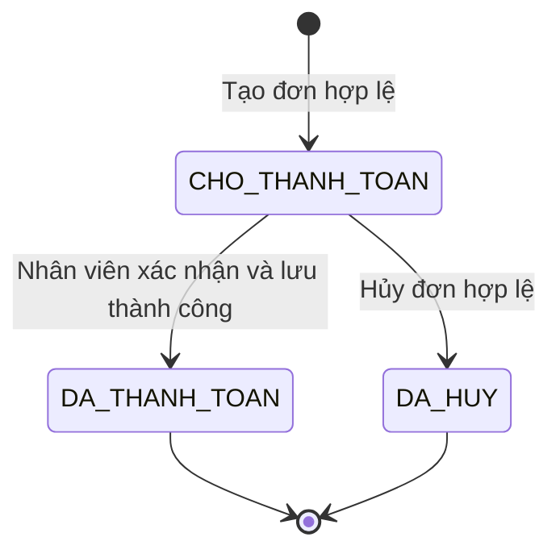

# 06. Quy tắc nghiệp vụ và kiểm thử

Các quy tắc dưới đây là chính sách giả lập của đồ án Java 24. Chúng là cơ sở chung cho chức năng, lớp và dữ liệu; không phải chính sách bán hàng của Vinamilk.

## 1. Kiểm tra dữ liệu đầu vào

- Tên đăng nhập được bỏ khoảng trắng hai đầu, chuyển chữ thường bằng `Locale.ROOT` và phải duy nhất. Mật khẩu không tự chuyển chữ thường hoặc cắt khoảng trắng.
- Tài khoản tự đăng ký luôn là khách hàng. Các chức năng ghi dữ liệu kiểm tra lại tài khoản hiện tại, trạng thái hoạt động và vai trò tại service.
- Tên sản phẩm, tên chương trình, tên nhà cung cấp không rỗng. SKU phải tham chiếu sản phẩm tồn tại.
- `LE` có `soDonViCoBan = 1`; `LOC` và `THUNG` có `soDonViCoBan > 1`. Không trùng bộ `(sanPhamId, loaiDongGoi, soDonViCoBan)`.
- Số lượng nhập/bán là số nguyên dương. Giá bán, giá nhập là số nguyên VND dương. Điểm, tồn kho và giá trị tồn không âm.
- Chỉ cho bán khi cả sản phẩm và SKU đang kinh doanh. Ngừng bán không xóa lịch sử hoặc lượng hàng còn tồn.
- Không sửa định danh sản phẩm, loại đóng gói hoặc số đơn vị của SKU đã tạo; nếu quy cách mới thì tạo SKU mới. Sửa tên/mô tả chỉ để hiệu chỉnh thông tin của cùng mặt hàng; thay dung tích, hương vị hoặc đơn vị cơ bản phải tạo sản phẩm mới, không đổi ý nghĩa lượng hàng đang tồn.
- Mọi phép cộng/nhân số lượng, tiền, điểm phải kiểm tra tràn số; dữ liệu vượt giới hạn bị từ chối trước khi cập nhật.
- Lỗi nhập số/ngày phải có thông báo và cho nhập lại, không làm chương trình thoát đột ngột.

## 2. Trạng thái và quyền xử lý đơn



| Trạng thái | Tồn kho, điểm, báo cáo | Quy tắc |
| --- | --- | --- |
| `CHO_THANH_TOAN` | Chưa trừ hàng/điểm, chưa tích điểm, chưa có doanh thu | Kiểm tra tồn khi đặt chỉ là thông tin tại lúc đó; phải kiểm tra lại khi thanh toán |
| `DA_THANH_TOAN` | Đã ghi cùng một lần: xuất hàng, giá vốn, điểm và doanh thu | Không sửa/xóa/hủy, không thanh toán lần hai |
| `DA_HUY` | Không có xuất kho hoặc thay đổi điểm | Không chuyển lại thành đơn chờ; cần mua lại thì tạo đơn mới |

Khách chỉ hủy đơn chờ của mình. Nhân viên được xử lý/hủy đơn chờ theo yêu cầu khách. Quản lý được đọc đơn phục vụ đối chiếu, không thực hiện thanh toán. Đơn chờ đã lưu không sửa dòng hàng trong phiên bản đầu; muốn đổi hàng thì hủy và tạo đơn khác.

Đơn `DA_HUY` bắt buộc có cả `nguoiHuyId` và `thoiDiemHuy`; hai trường này phải vắng mặt ở trạng thái khác. Service lấy người hủy từ phiên đăng nhập, kiểm tra chủ đơn hoặc quyền nhân viên rồi truyền vào `DonHang.huy(nguoiHuyId, lucHuy)`. Khi nạp lịch sử, kiểm tra tài khoản tồn tại và đúng vai trò, không yêu cầu người hủy vẫn đang hoạt động.

Đơn `DAT_TRUOC` luôn có khách hàng. Đơn `TAI_QUAY` có thể có khách đã đăng ký hoặc là khách vãng lai. Nếu khách gắn với đơn đã bị khóa, không thanh toán đơn đó; không tự chuyển sang khách vãng lai để bỏ qua trạng thái khóa.

Giỏ trước khi đặt là dữ liệu tạm trong RAM; thoát màn hình giỏ sẽ mất nội dung chưa xác nhận. Cùng một SKU xuất hiện nhiều lần phải được gộp số lượng vào một dòng trước khi tính giảm giá.

## 3. Khuyến mãi sản phẩm

Một `KhuyenMai` áp dụng cho một SKU, có ngày bắt đầu/kết thúc và trạng thái hoạt động. Ngày bắt đầu không sau ngày kết thúc; hai ngày biên đều được áp dụng theo ngày cửa hàng.

Với một dòng đã gộp SKU, đặt `B = donGiaBan × soLuong`:

| Loại khuyến mãi | Điều kiện | Tiền giảm trên dòng |
| --- | --- | --- |
| `KhuyenMaiPhanTram` | Tỷ lệ nguyên từ 1 đến 100 | `floor(B × tyLePhanTram / 100)` |
| `KhuyenMaiSoTien` | Số tiền giảm dương cho một đơn vị SKU | `min(donGiaBan, soTienGiam) × soLuong` |

Với công thức phần trăm, dùng `BigInteger` cho phép nhân/chia trung gian nếu `B × tyLePhanTram` có thể vượt `long`, rồi chuyển kết quả về `long` chính xác.

Giảm số tiền áp dụng **cho từng đơn vị SKU**, không phải từng hộp bên trong một lốc/thùng. Ví dụ 3 lốc giá 30.000 đ/lốc, giảm 5.000 đ/lốc thì giảm 15.000 đ và trả 75.000 đ; tách thành ba đơn một lốc vẫn trả tổng 75.000 đ nếu giá và chương trình không đổi, chưa tính điểm. UI hiển thị “giảm 5.000 đ/lốc”. Mức giảm mỗi đơn vị được chặn ở đơn giá trước khi nhân số lượng, tránh vượt tiền dòng và tránh nhân một mức giảm quá lớn rồi mới chặn.

Hợp đồng chung là `tinhTienGiam(long donGiaBan, int soLuong)`, với cả hai đầu vào dương. Kiểm tra `B` nằm trong miền `long` trước khi tính giảm; phép nhân giảm cố định dùng `Math.multiplyExact`.

Nếu có nhiều chương trình cùng hợp lệ, chọn chương trình tạo số tiền giảm lớn nhất cho dòng. Nếu bằng nhau, chọn mã chương trình theo thứ tự chuỗi tăng dần để kết quả ổn định. Nếu mọi mức giảm đều bằng 0, không ghi khuyến mãi áp dụng. Mỗi dòng chỉ dùng một chương trình; có thể cộng tiếp quyền lợi đổi điểm ở cấp đơn.

Giá bán và khuyến mãi được tính lại tại thời điểm nhân viên thanh toán. Dòng đơn đã thanh toán lưu mã, mô tả chương trình và số tiền giảm thực tế; sửa/ngừng chương trình sau đó không thay đổi đơn cũ.

## 4. Điểm và thứ tự tính tiền

Quy ước cố định của phiên bản đầu:

- Mỗi 10.000 đ **thực trả** được 1 điểm, làm tròn xuống theo từng đơn.
- Một điểm đổi được 1.000 đ giảm giá.
- Tổng tiền giảm từ điểm không quá 50% số tiền còn lại sau khuyến mãi sản phẩm.
- Không tự động sử dụng điểm. Khách chọn số điểm muốn dùng, hoặc chọn 0.
- Khách vãng lai không tích/đổi điểm. Điểm chỉ thuộc một tài khoản khách hàng, không chuyển nhượng, không hết hạn trong đồ án.
- Chỉ dùng số điểm đã có trước giao dịch; điểm kiếm được từ đơn hiện tại chưa được dùng trong chính đơn đó.

Các bước tính:

```text
tongTienHang       = tổng (donGiaBan × soLuong)
tongGiamKhuyenMai  = tổng tiền giảm của các dòng
tienSauKhuyenMai   = tongTienHang - tongGiamKhuyenMai
gioiHanDiemTheoTien = floor(tienSauKhuyenMai / 2.000)
diemToiDa          = min(diemHienCo, gioiHanDiemTheoTien)

Yêu cầu: 0 <= diemSuDung <= diemToiDa
tienGiamTuDiem     = diemSuDung × 1.000
tongThanhToan      = tienSauKhuyenMai - tienGiamTuDiem
diemNhanDuoc       = floor(tongThanhToan / 10.000)
diemHienCoMoi      = diemHienCo - diemSuDung + diemNhanDuoc
```

Với khách vãng lai, `diemSuDung = diemNhanDuoc = tienGiamTuDiem = 0` và không tạo `LichSuDiem`. Với khách thành viên, tạo một bản ghi lịch sử cho mỗi đơn đã thanh toán, kể cả khi điểm tăng/giảm đều bằng 0. Không ghi thêm bản ghi khi người dùng yêu cầu in lại đơn.

Lịch sử chỉ lưu điểm cộng/trừ của từng đơn, không lưu `soDuSau`. Số dư hiện tại nằm ở `KhachHang.diemTichLuy` và phải bằng tổng điểm cộng trừ tổng điểm đã dùng của toàn bộ lịch sử khách đó. Dùng `BigInteger` cho các tổng lịch sử trung gian; không suy ra chuỗi số dư từ thứ tự `Map`, UUID hoặc thời gian có thể trùng nhau.

Trước thanh toán, `diemSuDung` và khoản giảm tương ứng chỉ là dự kiến; `diemNhanDuoc` vẫn bằng 0. Đơn hủy giữ thông tin tạm tính để tra cứu nhưng không có điểm nhận hoặc lịch sử điểm.

Nếu khách yêu cầu số điểm quá giới hạn, báo rõ giới hạn mới và yêu cầu chọn lại; không âm thầm sửa số điểm đã chọn. Giá dự kiến thay đổi phải được khách xác nhận lại trước khi thu tiền. Nếu tổng thanh toán bằng 0 do giảm 100%, vẫn ghi nhận hoàn tất giao dịch, không nhận tiền và không cộng điểm.

### Ví dụ xuyên suốt

Khách có 50 điểm, mua 3 lốc sữa giá 30.000 đ/lốc và 2 phần phô mai giá 40.000 đ/phần. Sữa được giảm 10%; phô mai không có chương trình. Khách chọn dùng 20 điểm.

| Thành phần | Kết quả |
| --- | ---: |
| Tiền hàng | `3 × 30.000 + 2 × 40.000 = 170.000 đ` |
| Giảm khuyến mãi | `90.000 × 10% = 9.000 đ` |
| Sau khuyến mãi | `161.000 đ` |
| Giới hạn điểm | `min(50, floor(161.000 / 2.000)) = 50 điểm` |
| Giảm từ 20 điểm | `20.000 đ` |
| Thực trả | `141.000 đ` |
| Điểm nhận | `floor(141.000 / 10.000) = 14 điểm` |
| Số dư mới | `50 - 20 + 14 = 44 điểm` |

## 5. Tồn kho và giá vốn

Mỗi SKU có `tonKho` là số gói theo quy cách của nó và `giaTriTon` là **tổng giá vốn** của số gói đang tồn. Không nhân với số đơn vị cơ bản khi nhập/xuất SKU.

### Nhập hàng

```text
thanhTienNhap = soLuongNhap × donGiaNhap
tonKhoMoi    = tonKhoCu + soLuongNhap
giaTriTonMoi = giaTriTonCu + thanhTienNhap
```

Phiếu nhập có ít nhất một dòng và không trùng SKU. `tongTienNhap` là tổng thành tiền các dòng. Mọi hàng nhập được coi là đã trả tiền ngay; không theo dõi công nợ. Phiếu đã ghi nhận không sửa/xóa. SKU mới có tồn và giá trị tồn bằng 0; không có chức năng gõ lại số tồn tùy ý.

### Bán hàng

Với `0 < soLuongBan <= tonKhoTruoc`:

```text
giaVonDong   = floor(giaTriTonTruoc × soLuongBan / tonKhoTruoc)
tonKhoMoi    = tonKhoTruoc - soLuongBan
giaTriTonMoi = giaTriTonTruoc - giaVonDong
```

Đây là cách phân bổ giá vốn bình quân từ giá trị tồn. Phần đồng lẻ do chia không hết được giữ trong tồn; bán hết thì giá trị tồn về 0. Lưu `giaVonDong` vào `ChiTietDonHang.giaVon`, không tính lại từ giá nhập hiện tại khi xem báo cáo.

Ví dụ nhập 10 lốc giá 20.000 đ và 10 lốc giá 30.000 đ: tồn 20 lốc trị giá 500.000 đ. Bán 3 lốc có giá vốn 75.000 đ; còn 17 lốc trị giá 425.000 đ.

Phép nhân trung gian của công thức chia có thể vượt `long` dù kết quả vẫn hợp lệ. Khi lập trình, dùng `BigInteger` cho phép nhân/chia này rồi `longValueExact()`; với phép cộng/nhân tiền thông thường dùng `Math.addExact`/`Math.multiplyExact`. Không đổi sang số thực để tránh lỗi tràn.

### Đối soát với chứng từ

Khi nạp file và trước mỗi lần lưu, kiểm tra riêng từng SKU trên toàn bộ lịch sử:

```text
tonKho    = tổng soLuong nhập − tổng soLuong bán thuộc đơn DA_THANH_TOAN
giaTriTon = tổng (soLuong nhập × donGiaNhap) − tổng giaVon đã bán
```

Không tính đơn chờ hoặc hủy vào xuất kho. Tồn đầu đã có phiếu nhập nên không cộng thêm số dư mở đầu. Hai vế phải khớp chính xác và không âm; tồn bằng 0 phải có giá trị tồn bằng 0. Dùng `BigInteger` để cộng các tổng lịch sử rồi so với số tồn `int`/giá trị tồn `long`, vì tổng nhập và tổng bán tích lũy có thể vượt miền số dù số dư còn nhỏ. Sai lệch phải từ chối toàn bộ bộ dữ liệu, không tự sửa tồn theo chứng từ. Không tính lại giá vốn lịch sử bằng giá nhập hiện tại.

## 6. Trình tự thanh toán và lưu file

1. Xác nhận người thực hiện là nhân viên đang hoạt động và đơn còn chờ.
2. Kiểm tra khách hàng gắn với đơn, sản phẩm/SKU đang bán và đủ tồn cho mọi dòng.
3. `tinhTamDon` trả một `DonHangHienThi` bất biến gồm `thoiDiemTinhGia`, đơn/khách hàng, các dòng giá và khuyến mãi, điểm và tổng tiền. Điểm nhận trên báo giá là dự kiến theo tiền thực trả; `diemNhanDuoc` của đơn chờ trong storage vẫn bằng 0. Báo giá không ghi vào file và không chứa giá vốn.
4. UI hiển thị báo giá để khách xác nhận, nhân viên nhập số điểm đúng yêu cầu và xác nhận đã nhận tiền. Truyền đúng báo giá đã xác nhận vào `thanhToan`; không chỉ truyền một cờ đồng ý hoặc tổng tiền.
5. Khi bắt đầu `thanhToan`, lấy một `lucChot` theo giờ cửa hàng, kiểm tra lại quyền, trạng thái, tồn và điểm rồi tự tính lại theo dữ liệu tin cậy tại `lucChot`. Nếu ngày của báo giá khác ngày `lucChot`, hoặc đơn/khách/kênh bán, SKU, số lượng, tên/quy cách, đơn giá, mã/mô tả khuyến mãi, các khoản giảm, điểm/giới hạn điểm hay tổng tiền khác, không ghi giao dịch; trả báo giá mới để khách xác nhận lại. Không so toàn bộ thời điểm đến nano giây vì hai lần gọi luôn có thời gian khác nhau. Không tin các giá trị UI gửi để tính tiền.
6. Khi khớp báo giá đã xác nhận, dùng chính `lucChot` làm thời điểm thanh toán và thời điểm lịch sử điểm. Chuẩn bị bộ dữ liệu ứng viên gồm đơn đã trả, tồn mới, giá trị tồn mới, số dư điểm và lịch sử điểm. Tạo các `ChiTietDonHang` bất biến mới với giá vốn cuối cùng; không sửa phần tử của đơn cũ qua tham chiếu được giữ bên ngoài.
7. Kiểm tra toàn bộ bất biến và đối soát trên bộ ứng viên, ghi ra file tạm rồi thay file chính nguyên tử; chỉ sau khi thành công mới dùng trạng thái mới trong RAM.
8. In hóa đơn và báo thành công. Nếu phải xác nhận lại hoặc lỗi lưu khi nhân viên đã cầm tiền, giữ dữ liệu cũ và báo chưa hoàn tất; nhân viên phải hoàn lại hoặc đối chiếu khoản tiền đang giữ trước khi thử lại, không thu lần hai chỉ vì thao tác trước chưa lưu.

Chỉ một phiên bản ứng dụng được mở với cùng file dữ liệu. Cách xử lý file lỗi, dữ liệu tham chiếu và phiên bản định dạng được nêu ở [tài liệu 05](05-mo-hinh-du-lieu-va-luu-tru.md).

API danh mục và đơn hàng trả các đối tượng hiển thị bất biến, không trả entity có thể sửa trong storage. Khách chỉ nhận giá bán, ưu đãi và còn/hết hàng; nhân viên được xem thêm số tồn qua chức năng tồn kho. Giá vốn, giá nhập và giá trị tồn chỉ xuất hiện trong kết quả được kiểm tra quyền quản lý; phiếu nhập bất biến được trả qua service dành cho quản lý. Danh sách chỉ đọc không đủ nếu phần tử vẫn sửa được; cả `ChiTietDonHang` và `ChiTietPhieuNhap` phải bất biến, danh sách được sao chép bằng `List.copyOf` ngay khi nhận vào đối tượng cha.

## 7. Tổng kết tài chính

Chọn ngày bắt đầu và ngày kết thúc, tính cả hai ngày. Khi lọc thời gian dùng `>= đầu ngày bắt đầu` và `< đầu ngày kế tiếp sau ngày kết thúc` theo giờ cửa hàng.

| Chỉ tiêu | Công thức / nguồn |
| --- | --- |
| Số đơn đã bán | Đếm đơn `DA_THANH_TOAN` có `thoiDiemThanhToan` thuộc kỳ |
| Giá trị hàng trước giảm | Tổng `tongTienHang` của các đơn trên |
| Giảm khuyến mãi | Tổng `tongGiamKhuyenMai` của các đơn trên |
| Giảm từ điểm | Tổng `tienGiamTuDiem` của các đơn trên |
| Doanh thu thực thu | Tổng `tongThanhToan` của các đơn trên |
| Giá vốn hàng đã bán | Tổng `giaVon` của các dòng thuộc các đơn trên |
| Lãi gộp | Doanh thu thực thu − giá vốn hàng đã bán |
| Chi nhập hàng | Tổng `tongTienNhap` có `thoiDiemNhap` thuộc kỳ |
| Chênh lệch thu–chi trong kỳ | Doanh thu thực thu − chi nhập hàng |
| Giá trị tồn hiện tại | Tổng `giaTriTon` của toàn bộ SKU ở thời điểm xem, kể cả SKU đã ngừng bán |

Không dùng tổng tiền nhập trong kỳ thay cho giá vốn hàng đã bán. Không gọi chênh lệch thu–chi là lợi nhuận. Giá trị tồn hiện tại không được gắn nhãn là tồn cuối kỳ lịch sử.

Ví dụ nhập 20 lốc giá 20.000 đ, rồi bán 5 lốc giá 30.000 đ, không giảm: thu 150.000 đ, chi nhập 400.000 đ, giá vốn bán 100.000 đ, lãi gộp 50.000 đ, chênh lệch thu–chi −250.000 đ và tồn còn 300.000 đ.

## 8. Kịch bản nghiệm thu khi triển khai

Đây là các ca cần kiểm tra sau khi lập trình, **chưa phải kết quả kiểm thử một ứng dụng đã chạy**.

| Mã | Tình huống | Kết quả cần có |
| --- | --- | --- |
| KT-01 | Đăng ký hai tên chỉ khác hoa/thường hoặc khoảng trắng biên | Từ chối tên trùng sau chuẩn hóa |
| KT-02 | Khách gọi trực tiếp chức năng nhập hàng, bỏ qua menu | Service từ chối, dữ liệu không đổi |
| KT-03 | Khách A đọc/hủy đơn của khách B | Từ chối; không lộ nội dung đơn |
| KT-04 | Bán 2 lốc trong ví dụ tồn kho tài liệu 01 | Tồn lốc giảm từ 10 xuống 8; tồn lẻ/thùng giữ nguyên |
| KT-05 | Nhập số lượng 0, âm, chữ hoặc vượt `int` | Báo lỗi, cho nhập lại, không tạo giao dịch |
| KT-06 | Đặt 2 đơn cùng cần toàn bộ tồn còn lại; thanh toán đơn thứ nhất rồi đơn thứ hai | Đơn sau bị từ chối nếu thiếu; không âm kho hoặc trừ điểm |
| KT-07 | Giá hoặc khuyến mãi đổi sau khi đặt | Tính lại, hiển thị để khách xác nhận; không thu theo số cũ |
| KT-08 | Thực hiện ví dụ điểm mục 4 | Thực trả 141.000 đ, nhận 14 điểm, số dư 44 |
| KT-09 | Tiền sau KM 19.999 đ, khách có 100 điểm | Tối đa 9 điểm; yêu cầu 10 bị từ chối |
| KT-10 | Điểm hiện có 0, đơn sắp kiếm được 10 điểm | Không cho đổi 10 điểm ngay trong đơn đó |
| KT-11 | Thêm cùng SKU thành 1 rồi 2 lốc, giá 30.000 đ/lốc, giảm 5.000 đ/lốc | Gộp thành 3 lốc, giảm 15.000 đ, trả 75.000 đ |
| KT-12 | Một đơn vị SKU giá 30.000 đ có giảm 10% và giảm 5.000 đ | Chọn giảm 5.000 đ; bằng nhau chọn mã tăng dần |
| KT-13 | Mức giảm cố định lớn hơn đơn giá SKU hoặc giảm 100% | Dòng tối thiểu 0 đ; đơn 0 đ không phát sinh điểm nhận |
| KT-14 | Khuyến mãi đúng ngày bắt đầu/kết thúc, trước/sau khoảng đó | Hai ngày biên có hiệu lực; ngoài khoảng không áp dụng |
| KT-15 | Thanh toán lại đơn đã trả hoặc in lại đơn | Không trừ kho/điểm lần hai, không tăng doanh thu/điểm |
| KT-16 | Hủy đơn chờ hoặc bán cho khách vãng lai | Hủy không tác động kho/điểm; vãng lai không có lịch sử điểm |
| KT-17 | Ghi file thất bại khi thanh toán/nhập hàng | Giữ toàn bộ trạng thái cũ; không báo thành công |
| KT-18 | Thoát rồi mở lại | Khôi phục đúng tài khoản, subtype, đơn, tồn, điểm và chương trình |
| KT-19 | File hỏng, FK không tồn tại hoặc phiên bản không hỗ trợ | Báo lỗi và từ chối tải; không ghi đè bằng dữ liệu rỗng |
| KT-20 | Đổi tên/giá hàng hoặc ngừng chương trình sau khi bán | Nội dung hóa đơn và báo cáo cũ không đổi |
| KT-21 | Ví dụ nhập 20, bán 5 ở mục 7 | Phân biệt đúng lãi gộp 50.000 đ và thu–chi −250.000 đ |
| KT-22 | Tồn 3 đơn vị trị giá 10 đ, bán 1 rồi bán 2 | Giá vốn lần lượt 3 đ và 7 đ; cuối cùng tồn và giá trị tồn đều 0 |
| KT-23 | Đặt hôm trước, trả hôm sau; lọc ngày trả | Chỉ xuất hiện trong doanh thu ngày thanh toán |
| KT-24 | SKU ngừng bán hoặc khách bị khóa khi đơn còn chờ | Từ chối thanh toán; không âm thầm bỏ kiểm tra |
| KT-25 | Phép tính tiền hoặc điểm vượt miền số | Từ chối toàn giao dịch, không lưu giá trị bị tràn |
| KT-26 | Nhập 10 đơn vị giá 20.000 đ, bán 3 có giá vốn 60.000 đ; file ghi tồn 99 hoặc giá trị tồn 141.000 đ | Từ chối nạp; giá trị hợp lệ phải là tồn 7, giá trị tồn 140.000 đ; giữ nguyên file lỗi |
| KT-27 | Thử thêm/xóa dòng trong danh sách nhận từ đơn; thử sửa đối tượng dòng hoặc danh sách đầu vào sau constructor | Không thay đổi chứng từ; chi tiết không có setter, danh sách đầu vào đã được sao chép |
| KT-28 | Khách gọi API xem sản phẩm/đơn của mình; nhân viên xem đơn mình thu tiền | Kết quả không có giá vốn, giá trị tồn hoặc thông tin xác thực; khách chỉ có còn/hết hàng, không có số tồn chi tiết |
| KT-29 | Xem báo giá lúc 23:59, xác nhận sau 00:00 khi khuyến mãi hết hạn | Không lưu thanh toán theo báo giá cũ; trả báo giá mới và yêu cầu xác nhận lại; thời điểm tính cuối/ghi đơn/lịch sử điểm dùng chung `lucChot` |
| KT-30 | Hai báo giá có cùng tổng tiền nhưng đổi SKU, cơ cấu giảm hoặc số điểm | Yêu cầu xác nhận lại vì nội dung khác; không chỉ so tổng tiền |
| KT-31 | Khách tự hủy rồi nhân viên hủy một đơn khác theo yêu cầu khách | Mỗi đơn lưu đúng người hủy từ phiên; file có đơn hủy thiếu người hủy hoặc đơn chưa hủy có người hủy bị từ chối |
| KT-32 | Hai giao dịch điểm có thời gian trùng nhau; đảo thứ tự map khi nạp | Số dư hiện tại vẫn bằng tổng cộng trừ tổng dùng; không lưu/hiển thị số dư sau từng giao dịch dựa trên thứ tự suy đoán |
| KT-33 | Mua 3 lốc cùng SKU giá 30.000 đ/lốc, giảm 5.000 đ/lốc; so một đơn với ba đơn tại cùng giá/chương trình và không đổi điểm | Cả hai cách trả tổng 75.000 đ; mức giảm cố định không tăng nhờ tách đơn |
| KT-34 | Giảm 50.000 đ/đơn vị cho 3 đơn vị giá 30.000 đ | Chặn mức giảm ở 30.000 đ/đơn vị; giảm tổng 90.000 đ, không âm tiền |
| KT-35 | Tổng nhập/bán tích lũy vượt `long`, nhưng lượng tồn, giá trị tồn và điểm hiện tại vẫn trong miền kiểu tương ứng | Đối soát bằng tổng trung gian `BigInteger`, không từ chối chỉ vì tổng lịch sử trung gian tràn `long` |

Ưu tiên kiểm tra tự động các công thức, quyền sở hữu đơn, chuyển trạng thái một lần và tình huống ghi file thất bại. Kiểm tra menu và nhập liệu có thể thực hiện bằng kịch bản console ngắn.
