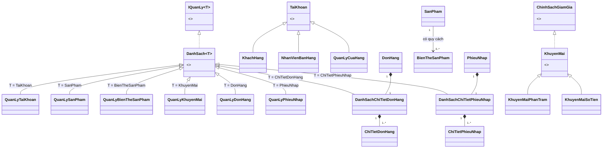

# 04. Tổng quan và mục lục thiết kế lớp

## 1. Cách chia trách nhiệm

Luồng gọi chính: `Main → GiaoDienConsole → DichVuCuaHang → lớp quản lý danh sách / đối tượng nghiệp vụ → LuuTruText`.

- **Đối tượng nghiệp vụ:** giữ dữ liệu và các quy tắc cục bộ, không đọc bàn phím hoặc tự ghi file.
- **Lớp quản lý danh sách:** quản lý tập đối tượng, tìm theo mã, kiểm tra trùng và cập nhật có kiểm soát; không chứa menu.
- **Dịch vụ:** kiểm tra vai trò, điều phối thay đổi nhiều danh sách và yêu cầu lưu file.
- **Giao diện:** nhập/xuất console, thông báo lỗi rõ ràng, cho nhập lại, không tự sửa điểm hay tồn kho.
- **Lưu trữ:** chuyển đối tượng thành bản ghi text và ngược lại, kiểm tra định dạng và tính toàn vẹn.

Mỗi lớp/interface/enum có một tài liệu `.md` riêng trong thư mục `lop/`, và khi triển khai sẽ có một file `.java` riêng. Để dễ học, có thể đặt toàn bộ trong package `cuahang` ở `src/cuahang/`; chưa cần chia module hoặc thêm framework.

## 2. Kiểu dữ liệu chung

| Loại | Dùng trong Java |
| --- | --- |
| Mã đối tượng | `String`, bất biến sau tạo; ID UUID sinh bằng `UUID.randomUUID().toString()`; mã ngắn trong ví dụ chỉ để đọc dễ |
| Tiền | `long`, đơn vị đồng, không âm; không dùng `double` |
| Số lượng, số điểm | `int`, kiểm tra không âm; lượng mua/nhập phải dương |
| Ngày áp dụng | `LocalDate` |
| Thời điểm tạo/thanh toán | `LocalDateTime`, thống nhất múi giờ nghiệp vụ `Asia/Ho_Chi_Minh` |
| Trạng thái hoạt động | `boolean` |
| Danh sách | Lớp cha generic `DanhSach<T>` giữ `List<T>`, khởi tạo bằng `ArrayList<T>`; mỗi lớp quản lý xác định kiểu `T` |

Phép nhân/cộng tiền và số lượng phải kiểm tra tràn số, ví dụ `Math.multiplyExact`, `Math.addExact`; tổng vượt miền kiểu dữ liệu phải bị từ chối trước khi ghi nhận.

## 3. Tài liệu riêng cho từng lớp

Mỗi tài liệu dưới đây mô tả trách nhiệm, thuộc tính, phương thức, quan hệ và các ràng buộc của đúng một kiểu Java. Mã nguồn tương ứng nằm trong `src/cuahang/`, mỗi kiểu một file cùng tên.

| Nhóm | Tài liệu riêng |
| --- | --- |
| Tài khoản | [TaiKhoan — abstract](lop/TaiKhoan.md), [KhachHang](lop/KhachHang.md), [NhanVienBanHang](lop/NhanVienBanHang.md), [QuanLyCuaHang](lop/QuanLyCuaHang.md) |
| Danh mục | [SanPham](lop/SanPham.md), [BienTheSanPham](lop/BienTheSanPham.md) |
| Khuyến mãi | [ChinhSachGiamGia — interface](lop/ChinhSachGiamGia.md), [KhuyenMai — abstract](lop/KhuyenMai.md), [KhuyenMaiPhanTram](lop/KhuyenMaiPhanTram.md), [KhuyenMaiSoTien](lop/KhuyenMaiSoTien.md) |
| Chứng từ | [DonHang](lop/DonHang.md), [ChiTietDonHang](lop/ChiTietDonHang.md), [PhieuNhap](lop/PhieuNhap.md), [ChiTietPhieuNhap](lop/ChiTietPhieuNhap.md) |
| Hợp đồng và lớp cha danh sách | [IQuanLy — interface](lop/IQuanLy.md), [DanhSach — abstract generic](lop/DanhSach.md) |
| Quản lý danh sách chung | [QuanLyTaiKhoan](lop/QuanLyTaiKhoan.md), [QuanLySanPham](lop/QuanLySanPham.md), [QuanLyBienTheSanPham](lop/QuanLyBienTheSanPham.md), [QuanLyKhuyenMai](lop/QuanLyKhuyenMai.md), [QuanLyDonHang](lop/QuanLyDonHang.md), [QuanLyPhieuNhap](lop/QuanLyPhieuNhap.md) |
| Danh sách thuộc từng chứng từ | [DanhSachChiTietDonHang](lop/DanhSachChiTietDonHang.md), [DanhSachChiTietPhieuNhap](lop/DanhSachChiTietPhieuNhap.md) |
| Điều phối và giao diện | [DichVuCuaHang](lop/DichVuCuaHang.md), [LuuTruText](lop/LuuTruText.md), [GiaoDienConsole](lop/GiaoDienConsole.md), [Main](lop/Main.md) |
| Enum | [VaiTro](lop/VaiTro.md), [LoaiSanPham](lop/LoaiSanPham.md), [KieuDongGoi](lop/KieuDongGoi.md), [TrangThaiDonHang](lop/TrangThaiDonHang.md) |

Tổng cộng **32 kiểu Java**: 23 class thông thường, 3 abstract class, 2 interface và 4 enum. Số này bao gồm một interface quản lý, một lớp cha generic và tám lớp danh sách cụ thể.

## 4. Interface và lớp cha generic cho danh sách

Quan hệ chung: `IQuanLy<T> ← implements — DanhSach<T> ← extends — lớp quản lý cụ thể`. Ví dụ `QuanLySanPham extends DanhSach<SanPham>` nên nhận `SanPham` khi thêm/sửa và trả `List<SanPham>` khi xuất.

[IQuanLy](lop/IQuanLy.md) khai báo bốn phương thức `List<T> xuat()`, `void them(T doiTuong)`, `void sua(String ma, T duLieuMoi)`, `void xoa(String ma)`. Interface quy định hợp đồng; không dùng Java `default` để chứa sẵn logic thay đổi dữ liệu.

[DanhSach](lop/DanhSach.md) là abstract class implements interface đó, giữ `protected final List<T> danhSach` và triển khai `xuat()` bằng `List.copyOf(danhSach)`. Ba phương thức thay đổi dữ liệu là abstract để lớp con bắt buộc override theo nghiệp vụ. Lớp con kế thừa danh sách có kiểu, không tạo thêm trường danh sách và không cần lặp lại `implements`.

Tất cả tám lớp danh sách dùng trường/phương thức instance. [Main](lop/Main.md) tạo một đối tượng cho mỗi lớp `QuanLy...`, truyền cùng sáu tham chiếu cho dịch vụ và lưu trữ để dùng xuyên suốt các phiên đăng nhập. Hai lớp danh sách chi tiết được tạo riêng cho từng đơn/phiếu, không dùng chung giữa các chứng từ.

`xuat()` xuất dữ liệu cho nơi gọi duyệt; [GiaoDienConsole](lop/GiaoDienConsole.md) định dạng và in các trường được phép xem sau khi dịch vụ kiểm tra quyền. `List.copyOf` chỉ bảo vệ cấu trúc; thuộc tính nghiệp vụ vẫn phải private. Không cung cấp setter tự do cho mã, điểm, tồn hoặc trạng thái chứng từ.

Hợp đồng có đủ sửa/xóa nhưng vẫn giữ quy tắc nghiệp vụ: sáu danh sách chung từ chối xóa vật lý bằng `UnsupportedOperationException`; danh sách đơn/phiếu cũng từ chối sửa tùy ý. Khóa tài khoản, ngừng bán, ngừng khuyến mãi, hủy/thanh toán đơn vẫn đi qua các hành vi chuyên biệt. Danh sách chi tiết chỉ cho thêm/sửa/xóa lúc soạn, kể cả khi được tham chiếu qua `IQuanLy<T>`.

## 5. Lựa chọn mô hình OOP

Ba loại tài khoản cùng kế thừa trực tiếp `TaiKhoan`; quản lý có quyền bán hàng qua kiểm tra quyền, không cần kế thừa nhân viên. Vai trò được suy ra từ lớp cụ thể, không đổi loại tài khoản sau tạo.

Năm nhóm hàng dùng enum vì chưa có hành vi riêng cần override. Quy cách là đối tượng `BienTheSanPham` gắn với sản phẩm bằng mã; không tạo các lớp `Sua`, `Kem`, `PhoMai` chỉ để đổi nhãn. Mỗi SKU có giá và tồn độc lập.

`List<KhuyenMai>` chứa cả hai lớp khuyến mãi. Khi gọi `tinhTienGiam`, Java chọn đúng phương thức override của đối tượng. Phân loại bản ghi khi đọc/ghi text thuộc biên lưu trữ; công thức tính giảm giá sử dụng đa hình.

`DichVuCuaHang`, `LuuTruText`, `GiaoDienConsole` là đối tượng instance, tạo một lần trong `Main` và truyền tham chiếu qua constructor. Chưa cần lớp `HoaDon`, `GioHang`, `LichSuDiem` hoặc `BaoCao` riêng: dùng dữ liệu đơn hàng, chi tiết và phép tổng hợp chứng từ.

## 6. Sơ đồ và minh chứng OOP

Sơ đồ thể hiện chứng từ đã được lưu; danh sách đang soạn trong RAM có thể tạm rỗng. Mũi tên sản phẩm–biến thể là liên kết bằng mã, không phải kế thừa.

| Tính chất | Cách chứng minh khi báo cáo đồ án |
| --- | --- |
| Đóng gói | Thuộc tính nghiệp vụ private; danh sách chỉ lớp cha/lớp con truy cập; `truDiem`, `giamTon` kiểm tra hợp lệ; không lộ danh sách có thể thêm/xóa trực tiếp |
| Kế thừa | Ba lớp tài khoản kế thừa `TaiKhoan`; hai cách khuyến mãi kế thừa `KhuyenMai`; tám lớp danh sách kế thừa `DanhSach<T>` |
| Đa hình | `IQuanLy<SanPham>` gọi override của `QuanLySanPham`; `List<KhuyenMai>` gọi `tinhTienGiam` khác nhau; `TaiKhoan.layVaiTro()` được override |
| Trừu tượng | Không khởi tạo trực tiếp `TaiKhoan`/`KhuyenMai`/`DanhSach<T>`; hai interface quy định hợp đồng quản lý và tính giảm giá |
| Generic | Một lớp cha `DanhSach<T>` dùng cho tám kiểu phần tử, kiểm tra kiểu ngay khi biên dịch |
| Composition | Đơn/phiếu sở hữu danh sách chi tiết và vòng đời chi tiết |
| Thành viên static | `Main.main` là điểm vào; dữ liệu danh sách thuộc các đối tượng quản lý dùng chung được truyền qua constructor |

Đối chiếu các thuộc tính với [mô hình dữ liệu](05-mo-hinh-du-lieu.md) và [quy tắc nghiệp vụ](06-quy-tac-nghiep-vu.md).
