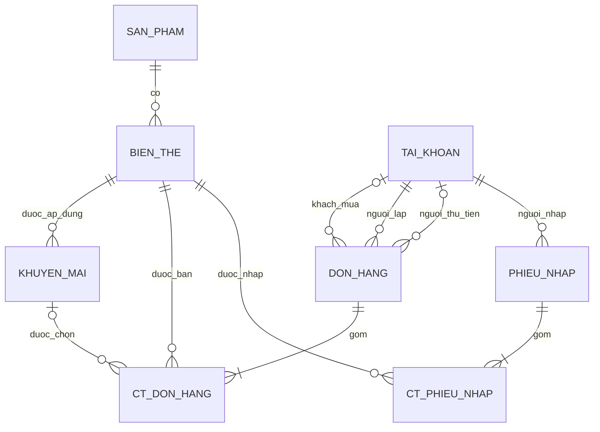

# 05. Mô hình dữ liệu

## 1. Thiết kế như bảng dữ liệu, triển khai bằng đối tượng

“Bảng” trong tài liệu chỉ là cách tổ chức dữ liệu có khóa và quan hệ, không phải bảng SQL. Chương trình đọc các bản ghi vào đối tượng Java và quản lý bằng danh sách. Các lớp dịch vụ và quản lý danh sách không phải thực thể nên không có bảng riêng.

| Bảng logic | Lớp trong RAM | Khóa chính | Khóa ngoại / liên kết |
| --- | --- | --- | --- |
| `TAI_KHOAN` | `KhachHang`, `NhanVienBanHang`, `QuanLyCuaHang` | `maTaiKhoan` | Không có |
| `SAN_PHAM` | `SanPham` | `maSanPham` | Không có |
| `BIEN_THE` | `BienTheSanPham` | `maBienThe` | `maSanPham → SAN_PHAM` |
| `KHUYEN_MAI` | `KhuyenMaiPhanTram`, `KhuyenMaiSoTien` | `maKhuyenMai` | `maBienThe → BIEN_THE` |
| `DON_HANG` | `DonHang` | `maDonHang` | `maKhachHang`, `maNguoiLap`, `maNguoiThuTien → TAI_KHOAN` |
| `CT_DON_HANG` | `ChiTietDonHang` | `(maDonHang, maBienThe)` | `maDonHang → DON_HANG`, `maBienThe → BIEN_THE`, `maKhuyenMai → KHUYEN_MAI` nếu có |
| `PHIEU_NHAP` | `PhieuNhap` | `maPhieuNhap` | `maNguoiNhap → TAI_KHOAN` |
| `CT_PHIEU_NHAP` | `ChiTietPhieuNhap` | `(maPhieuNhap, maBienThe)` | `maPhieuNhap → PHIEU_NHAP`, `maBienThe → BIEN_THE` |

`TAI_KHOAN` lưu cả ba lớp con trong một bảng, dùng `vaiTro` để khôi phục đúng lớp khi đọc. `KHUYEN_MAI` dùng `loaiKhuyenMai` tương tự. Đây là ánh xạ một cây kế thừa vào một bảng, không cần ba danh sách tài khoản tách biệt.



Quan hệ khách mua chỉ chấp nhận `KhachHang`; người thu tiền là nhân viên hoặc quản lý; người nhập là quản lý. Một đơn vãng lai không có khách thành viên, một đơn chưa thanh toán không có người thu tiền. Sơ đồ mô tả chứng từ đã lưu nên mỗi chứng từ có ít nhất một dòng hàng.

## 2. Từ điển dữ liệu và thứ tự cột

Các dòng dưới đây cũng là thứ tự cột chính thức của định dạng text phiên bản 1. Từ đầu dòng là tên loại bản ghi, không phải một thuộc tính đối tượng. Kiểu Java của các trường được xác định trong [Thiết kế lớp](04-thiet-ke-lop.md).

### Tài khoản

```text
TAI_KHOAN|maTaiKhoan|vaiTro|tenDangNhap|salt|soVongBam|matKhauBam|hoTen|soDienThoai|dangHoatDong|diemTichLuy
```

- `vaiTro`: một trong ba giá trị `VaiTro`, được suy ra từ lớp con khi ghi.
- `tenDangNhap`: trim và chuyển chữ thường bằng `Locale.ROOT`; không rỗng, duy nhất sau chuẩn hóa. Mật khẩu không bị trim hoặc đổi chữ.
- `salt`, `matKhauBam`: Base64; `soVongBam` là số nguyên dương, lưu để có thể xác thực lại với đúng tham số. Thuật toán của phiên bản 1 là PBKDF2-HMAC-SHA256; kiểm tra kích thước và giới hạn tham số khi đọc.
- `diemTichLuy`: số nguyên không âm cho khách hàng, **để trống** với nhân viên/quản lý. Không tạo điểm cho tài khoản nội bộ.
- `soDienThoai` là chuỗi để giữ số 0 đầu, không dùng kiểu số. Họ tên, số điện thoại là trường bắt buộc.

### Sản phẩm và biến thể

```text
SAN_PHAM|maSanPham|tenSanPham|thuongHieu|donViCoSo|dinhLuong|moTa|loai|dangKinhDoanh
BIEN_THE|maBienThe|maSanPham|tenQuyCach|kieuDongGoi|soDonViCoSo|giaBan|soLuongTon|dangKinhDoanh
```

- Sản phẩm: tên, thương hiệu, đơn vị cơ sở, định lượng không rỗng; mô tả có thể trống. Nhóm hàng thuộc `LoaiSanPham`.
- Biến thể: tên quy cách không rỗng, giá bán > 0, tồn ≥ 0. `BAN_LE` có 1 đơn vị cơ sở; `LOC` và `THUNG` có số đơn vị cơ sở > 1.
- Không trùng bộ `(maSanPham, kieuDongGoi, soDonViCoSo)`. Hai thùng 24 và 48 đơn vị là hai biến thể hợp lệ; thùng 24 không được tạo hai lần cho cùng sản phẩm.
- Mã và liên kết sản phẩm–SKU không đổi sau tạo. Nếu đổi định lượng, đơn vị cơ sở hay cấu tạo quy cách làm thành hàng khác, tạo sản phẩm/SKU mới. Không dùng sửa tên để biến sữa 180 ml đã có lịch sử thành sữa 1 lít.
- Không xóa danh mục; dùng cờ ngừng kinh doanh. SKU chỉ bán được khi cả SKU và sản phẩm cha đang kinh doanh.

### Khuyến mãi

```text
KHUYEN_MAI|maKhuyenMai|loaiKhuyenMai|tenKhuyenMai|maBienThe|tuNgay|denNgay|dangApDung|giaTri
```

- `loaiKhuyenMai = PHAN_TRAM`: `giaTri` ánh xạ vào `tyLePhanTram` (1–100).
- `loaiKhuyenMai = SO_TIEN`: `giaTri` ánh xạ vào `soTienGiamMoiDonVi` (> 0).
- Mỗi chương trình áp dụng một SKU; muốn cùng chương trình cho nhiều SKU thì tạo từng bản ghi. Chưa cần bảng trung gian nhiều–nhiều.
- Ngày bắt đầu ≤ ngày kết thúc; bao gồm cả hai đầu ngày. Không xóa bản ghi, chỉ sửa/ngừng cho lần bán tiếp theo. `maBienThe` và loại giảm không đổi sau tạo; đổi đối tượng/loại áp dụng thì tạo chương trình mới.

### Đơn và chi tiết đơn

```text
DON_HANG|maDonHang|maKhachHang|maNguoiLap|maNguoiThuTien|thoiDiemTao|thoiDiemThanhToan|trangThai|diemSuDung|diemCong|tongTienHang|tongGiamKhuyenMai|tienGiamDiem|tongThanhToan
CT_DON_HANG|maDonHang|maBienThe|tenSanPhamLucBan|tenQuyCachLucBan|soLuong|donGia|maKhuyenMai|tienGiamKhuyenMai
```

- Đơn chờ/hủy: người thu tiền và thời điểm thanh toán để trống; `diemSuDung`, `diemCong`, `tienGiamDiem` bằng 0. Các tổng khác là tạm tính đã lưu, không phải doanh thu.
- Đơn đã thanh toán: bắt buộc có người thu tiền/thời điểm; thời điểm thanh toán không trước thời điểm tạo. Tổng tiền không âm và khớp các dòng cùng công thức ở tài liệu 06.
- Dòng hàng: số lượng > 0, đơn giá > 0; giảm giá nằm trong `[0, số lượng × đơn giá]`. Không có `maKhuyenMai` thì tiền giảm khuyến mãi bằng 0.
- Nếu có mã khuyến mãi thì phải tham chiếu chương trình của đúng SKU. Không dùng ngày/giá trị khuyến mãi hiện tại để kiểm tra lại số tiền giảm của hóa đơn cũ vì quản lý có thể đã cập nhật chương trình.
- Tên sản phẩm/quy cách, đơn giá, mã khuyến mãi và số tiền giảm là dữ liệu chụp tại giao dịch. Đây là phần lặp có chủ đích để bảo toàn lịch sử dù danh mục thay đổi.
- `maNguoiLap` thuộc khách thì phải chính là `maKhachHang`; nếu không thì phải là nhân viên/quản lý. Không thay khách được gắn vào một đơn đã lưu; hủy đơn chờ và lập lại nếu chọn nhầm.

### Phiếu và chi tiết nhập

```text
PHIEU_NHAP|maPhieuNhap|maNguoiNhap|tenNguonNhap|thoiDiemNhap
CT_PHIEU_NHAP|maPhieuNhap|maBienThe|tenSanPhamLucNhap|tenQuyCachLucNhap|soLuong|donGiaNhap
```

- `tenNguonNhap` là tên đơn vị/người cung cấp, bắt buộc; không phải khóa ngoại vì chưa quản lý nhà cung cấp riêng.
- Số lượng và giá nhập > 0. Giá nhập là giá một SKU, ví dụ giá nhập một thùng, không phải giá một hộp trong thùng.
- Phiếu nhập đã lưu luôn là phiếu đã nhận hàng và trả đủ tiền, bất biến. Không cần enum trạng thái phiếu nhập trong phiên bản đầu.
- Tổng tiền phiếu = tổng số lượng × giá nhập, tính lại từ chi tiết; không cần lưu thêm cột tổng.

Cách biểu diễn các bảng trong file, kiểm tra dữ liệu và lưu an toàn nằm trong [Lưu trữ file text](07-luu-tru-file-text.md).
