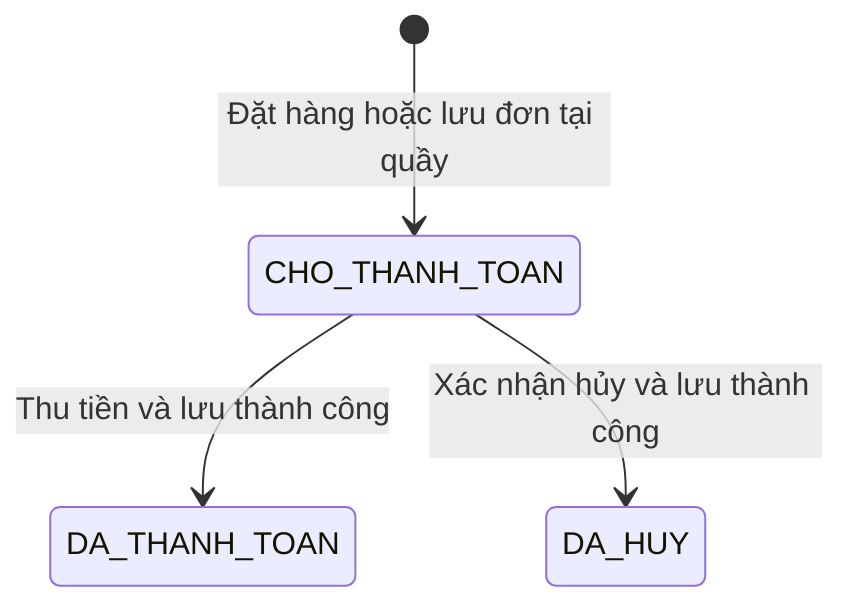

# 06. Quy tắc nghiệp vụ

Các quy tắc dưới đây là đặc tả cần triển khai. Các tình huống kiểm chứng nằm trong [Kế hoạch kiểm thử](08-ke-hoach-kiem-thu.md).

## 1. Sản phẩm, đóng gói và tồn

- Có đúng năm nhóm hàng trong `LoaiSanPham`; quy cách nằm trong `BienTheSanPham`, không kế thừa sữa từ lốc hoặc thùng.
- Đơn vị đặt/nhập luôn là SKU. Ví dụ lốc 4 hộp, mua 3 lốc thì lượng bán là 3, số hộp mô tả là 12; chỉ tồn SKU lốc giảm 3.
- SKU mới có tồn 0. Chỉ phiếu nhập đã ghi nhận làm tăng tồn; chỉ đơn đã thanh toán làm giảm tồn. Không cho sửa tồn trực tiếp từ menu.
- Mỗi chứng từ có ít nhất một dòng, mỗi SKU tối đa một dòng. Số lượng nguyên dương; kiểm tra tổng sau khi gộp dòng, không chỉ kiểm tra từng lần chọn.
- Đặt hàng kiểm tra tồn hiện tại nhưng không giữ hàng. Thanh toán phải kiểm tra lại tồn và trạng thái kinh doanh của cả sản phẩm cha và SKU.
- Mã/đơn vị/định lượng/quy cách đã xác định hàng hóa không được sửa thành một loại hàng khác. Đổi giá và mô tả không được viết lại dữ liệu chụp trong chứng từ cũ.

## 2. Vòng đời đơn hàng



Không có đường chuyển từ đã thanh toán hoặc đã hủy về chờ. Một yêu cầu thanh toán lần hai trả lỗi “Đơn đã thanh toán”, không trừ tồn/điểm thêm. In lại hóa đơn là thao tác đọc.

Đơn chờ có tổng tạm tính và không áp dụng điểm; tại quầy, tính lại giá/khuyến mãi hiện hành rồi khách chọn điểm. Nếu khách chưa đồng ý tổng cuối, đơn vẫn chờ, các danh sách không đổi. Đơn đã lưu không sửa người mua hoặc các dòng qua menu; muốn đổi giỏ hàng thì hủy đơn chờ và lập lại. Điều chỉnh dòng trước khi lưu vẫn được phép.

## 3. Công thức khuyến mãi

Với một dòng: `g` là giá bán một SKU, `q` là số lượng, `T = g × q`.

| Loại | Công thức tiền giảm dòng |
| --- | --- |
| Giảm phần trăm `p` | `floor(T × p / 100)`; `1 ≤ p ≤ 100` |
| Giảm số tiền `a`/SKU | `min(a, g) × q`; `a > 0` |

Chương trình hợp lệ khi đúng SKU, đang áp dụng và `tuNgay ≤ ngày thanh toán ≤ denNgay`. Tính bằng số nguyên đồng; phần trăm làm tròn xuống **trên cả dòng**, không làm tròn từng đơn vị rồi nhân lượng. Phải tránh hoặc phát hiện tràn số ở bước nhân trung gian.

Nếu có nhiều chương trình hợp lệ, tính số tiền giảm của từng chương trình bằng đa hình, chọn mức lớn nhất. Nếu bằng nhau, chọn `maKhuyenMai` nhỏ nhất theo `String.compareTo` để kết quả ổn định. Không cộng chồng hai chương trình trên cùng dòng. Khi không có chương trình, mức giảm bằng 0 và mã khuyến mãi null.

Khuyến mãi số tiền lớn hơn đơn giá được chặn ở mức đơn giá, nên tiền sau giảm không âm. Một đơn tổng 0 sau khuyến mãi vẫn có thể hoàn tất giao hàng; không thu tiền hoặc tích điểm, nhưng vẫn trừ tồn khi lưu thành công.

## 4. Công thức đổi và tích điểm

Các tỷ lệ dưới đây là chính sách cố định của đồ án phiên bản 1, không cần thêm bảng cấu hình:

```text
tongTienHang       = tổng (đơn giá × số lượng)
tongGiamKhuyenMai  = tổng tiền giảm khuyến mãi của từng dòng
sauKhuyenMai       = tongTienHang − tongGiamKhuyenMai
diemToiDaTheoTien  = floor(sauKhuyenMai / 500)
diemToiDaDuocDung  = min(diemHienCo, diemToiDaTheoTien)
0 ≤ diemSuDung ≤ diemToiDaDuocDung
tienGiamDiem       = diemSuDung × 100
tongThanhToan      = sauKhuyenMai − tienGiamDiem
diemCong           = floor(tongThanhToan / 10000)
diemSauGiaoDich    = diemHienCo − diemSuDung + diemCong
```

`floor(sauKhuyenMai / 500)` tương đương giới hạn tiền đổi điểm không vượt 20% sau khuyến mãi, khi một điểm bằng 100 đồng. Đổi điểm nguyên, không tự làm tròn lên. Nếu nhập điểm vượt mức, báo mức tối đa và yêu cầu nhập lại, không tự đổi số khác mà không thông báo.

Đối với khách vãng lai: cả điểm dùng, điểm cộng và tiền giảm điểm đều bằng 0; không áp công thức tích điểm cho đơn không có khách. Nhân viên chỉ đổi điểm khi đúng chủ tài khoản thành viên đồng ý; không tự dùng điểm chỉ vì tra được số điện thoại.

Điểm được cập nhật cùng giao dịch thanh toán, điểm mới chỉ dùng từ lần mua sau. Lịch sử điểm chính là các đơn đã thanh toán có `diemSuDung`/`diemCong`; chưa có hạn dùng điểm, chuyển điểm, tặng điểm đăng ký hoặc sửa điểm thủ công.

### Ví dụ kiểm chứng

Khách có 250 điểm, mua 2 lốc giá 30.000đ/lốc. SKU có hai khuyến mãi cùng hợp lệ: giảm 10% hoặc giảm 2.000đ/lốc. Khách đồng ý dùng 100 điểm.

| Bước | Kết quả |
| --- | ---: |
| Tiền hàng | 2 × 30.000 = 60.000đ |
| Giảm theo phần trăm | 60.000 × 10% = 6.000đ |
| Giảm theo số tiền | 2 × 2.000 = 4.000đ |
| Khuyến mãi được chọn | Giảm 6.000đ |
| Sau khuyến mãi | 54.000đ |
| Điểm tối đa được dùng | min(250, floor(54.000/500)) = 108 điểm |
| Đổi 100 điểm | Giảm 10.000đ |
| Tiền phải trả | 44.000đ |
| Điểm cộng | floor(44.000/10.000) = 4 điểm |
| Điểm còn lại | 250 − 100 + 4 = 154 điểm |

Sau lưu thành công, tồn SKU lốc giảm 2, thu bán tăng 44.000đ. Tồn hộp lẻ/thùng không đổi. Số dư 250 điểm đầu ví dụ phải đến từ các giao dịch trước; đây là dữ kiện bài tính, không phải cơ chế nạp điểm tùy ý.

## 5. Nhập hàng và báo cáo

Nhập hàng cần quản lý đang hoạt động, SKU tồn tại, nguồn nhập không rỗng, số lượng và giá nhập dương. Không cần SKU đang mở bán mới được nhập; nhập SKU ngừng bán không tự mở lại SKU. Ghi nhận phiếu đồng nghĩa đã nhận hàng và trả đủ tiền. Không hỗ trợ phiếu nợ hoặc sửa phiếu đã ghi nhận.

Khi chọn lại SKU trong lúc soạn phiếu, gộp lượng vào một dòng. Nếu nhập giá khác thì yêu cầu chọn lại **một đơn giá cho toàn dòng** hoặc tách thành phiếu khác; không giữ hai dòng cùng khóa. Phiếu cùng mã không được ghi nhận lần hai.

Trong khoảng ngày A–B (bao gồm hai đầu):

- Thu bán = tổng `tongThanhToan` của đơn đã thanh toán có ngày thanh toán trong kỳ.
- Doanh thu gộp và hai khoản giảm lấy từ giá trị đã chốt của các đơn đó, không tính bằng giá hiện tại.
- Chi nhập = tổng tiền các phiếu có ngày nhập trong kỳ.
- Chênh lệch = thu bán − chi nhập, có thể âm; không gắn nhãn lợi nhuận.
- Tồn hiển thị là tồn hiện tại, không phải tồn cuối kỳ được tái lập theo lịch sử.

Ví dụ trong kỳ chỉ nhập 10 lốc giá 24.000đ/lốc và bán đơn 44.000đ ở trên: thu 44.000đ, chi nhập 240.000đ, chênh lệch −196.000đ. Tám lốc nhập chưa bán không có nghĩa toàn bộ chi nhập đã trở thành chi phí của hai lốc bán ra.

